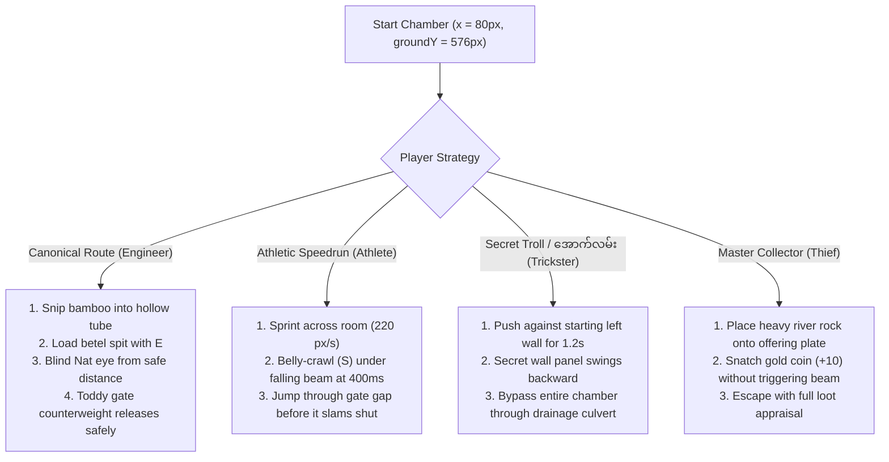

# Sample Brainstorm Session: The Weeping Nat Chamber

*A complete demonstration of how `idea-creator` generates game mechanics, troll traps, and puzzle solutions by blending Burmese folklore with global cinema.*

---

## 🏛️ Chamber Concept: The Weeping Nat Chamber & The Sticky Toddy Gate
### (နတ်ရုပ်မျက်ရည်နှင့် ထန်းရည်စေးတံခါး)

### 🎬 Cultural & Cinematic Lineage (The "Inspired By" Matrix)
* **Global Cinema & Media:**
  - *Indiana Jones: Raiders of the Lost Ark* — Weight-sensitive idol pedestal that triggers stone crushing blocks.
  - *Home Alone* — Sticky glue and feather tripwire trap.
  - *Buster Keaton: Steamboat Bill, Jr.* — Falling architectural beam where ducking into a gap avoids death.
* **Burmese Folklore & Satire:**
  - *U Paw U Trick #7: The Crying Nat Statue* — Royal priests made a Nat statue "weep tears of blood" using hidden betel juice tubes; U Paw U exposed it by tasting the liquid.
  - *Maung Pauk Kyaing: Slaying the Naga* — Decoy dummy soaked in sticky palm toddy sap to immobilize the beast's jaws.
  - *Upper-Burma Village Satire:* U Gyi mocking Phoe Htaung for bowing to a stone statue that is actually an automated pressure trap.

---

### ⚠️ The Trap & Hazard Architecture
* **The Seductive Greed Trap (The Weeping Nat):**
  - At $x = 720\text{px}$, an ancient stone Nat statue stands holding a glistening golden offering bowl containing a sparkling antique gold coin ($+10$ gold).
  - Standing on the stone rug in front of the statue ($x = 680\text{–}760\text{px}$) triggers a hidden ceiling counterweight.
* **The Visual / Audio Telegraph:**
  - A subtle creaking wood sound (*Creakkk!*) and fine red dust particles drifting from the ceiling archway ($y = 200\text{px}$).
* **The Slapstick Cushion (Hit 1):**
  - If Phoe Htaung steps on the plate carelessly, a giant hanging clay toddy pot drops directly on his head.
  - Instead of dying, the pot smashes, soaking Phoe Htaung in sticky palm syrup (`scaleY: 0.5, scaleX: 1.3`). Phoe Htaung waddles sluggishly with syrup dripping from his ears while dizzy yellow cartoon stars spin around him.
  - **Death Count:** Remains at 0.
  - **U Gyi Roast:** *"ဟိတ်ကောင် ဖိုးထောင်! နတ်က ကန်တော့ခံချင်တာ မဟုတ်ဘူး၊ မင်းခေါင်းကို ထန်းရည်အိုးနဲ့ ထုချင်နေတာကွ! မျက်လုံးပါရင် ကြည့်လျှောက်စမ်း!"*
* **The Escalated Lethal Hazard (Hit 2+):**
  - Triggering the plate a second time causes a massive 200kg teak roof beam to slam down. Phoe Htaung is flattened into a paper-thin cartoon accordion with his tongue sticking out. Instant quick-reset available with <kbd>R</kbd>.

---

### 🎒 Diegetic Item Combinations & Interactions

| Item A | Item B / Target | Result / Crafted Item | Verb / Mechanism |
| :--- | :--- | :--- | :--- |
| `betel_cutter` (✂️) | `bamboo_pole` (🎋) | `hollow_reed_tube` (🪈) | Cut bamboo joint inside Shan bag. |
| `mouth_verb` (<kbd>E</kbd>) | `hollow_reed_tube` | `blowpipe_spit` (🎯) | Spits red betel juice through tube from $180\text{px}$ away into the Nat statue's eye. |
| `longyi_strip` (🧣) | `sticky_toddy_puddle` | `sticky_traction_wrap` (👟) | Wraps sticky longyi cloth around flip-flops to run across frictionless oiled floor. |

---

### 🏆 The 4-Route Winning Matrix



1. **Route 1: The Canonical Mechanical Route (The Engineer's Way):**
   - Phoe Htaung uses his heirloom `betel_cutter` on the raw bamboo stalk collected near the entrance to craft a `hollow_reed_tube`.
   - Standing safely outside the pressure trigger ($x = 600\text{px}$), he aims at the Nat statue's face and presses <kbd>E</kbd> to spit red betel juice through the reed tube (*Phhhht!*).
   - The sticky red juice blinds the statue's mechanical optical sensors. The mechanism jams, smoothly lowering the heavy teak gate at $x = 1180\text{px}$.
2. **Route 2: The Athletic Speedrun Bypass (The Athlete's Way):**
   - Without crafting or picking up items, the speedrunner sprints directly across the floor.
   - As the heavy teak beam drops ($t = 1.8\text{s}$), the player holds <kbd>S</kbd> to drop into a low belly-crawl ($h = 25.2\text{px}$).
   - The crushing beam stops at $y = 540\text{px}$, leaving a $36\text{px}$ gap. Phoe Htaung slides smoothly underneath, pops back up with <kbd>Space</kbd>, and clears the exit door in under 3.8 seconds!
3. **Route 3: The Secret Troll / "အောက်လမ်း" Route (The Trickster's Way):**
   - Instead of heading right toward the magnificent golden shrine, the player pushes left against the starting dungeon wall for 1.2 seconds.
   - A hidden drainage culvert flap opens with a squeak. Phoe Htaung belly-crawls into the wall, bypassing the entire trap room and emerging directly on the other side of the exit gate!
   - U Gyi exclaims in disbelief: *"အမလေးလေး... ရှေ့က နတ်ကို မကိုးကွယ်ဘဲ နောက်ဖေးရေမြောင်းထဲ ဝင်ပြေးတဲ့ ငကြောင်ပဲကွ!"*
4. **Route 4: The Master Collector / Relic Heist (The Thief's Way):**
   - Phoe Htaung picks up a 15kg river boulder from the mud pool.
   - Using precision timing, he swaps the golden relic with the boulder on the offering bowl (Indiana Jones style).
   - Collects the $+10$ Gold Ancient Sovereign without triggering the ceiling drop, achieving a 100% relic score!

---

### 🗣️ U Gyi's Overhead Banter Script (`top: 14%`)

* **Room Entry (Ambient):**
  > *"ဟိတ်ကောင် ဖိုးထောင်... ဟိုရှေ့က နတ်ရုပ်ကြီးကို ကြည့်စမ်း။ မျက်နှာက မင်းလိုပဲ မသာဆန်လိုက်တာ... သတိထားလျှောက်နော်!"*
* **Idle Nudge (Standing still > 8 seconds):**
  > *"ဘာကြောင်ကြည့်နေတာလဲ? လက်ထဲမှာ ပါတဲ့ ဝါးလုံးနဲ့ ကွမ်းသီးညှပ်ကို အိတ်ထဲမှာ ထည့်မွှေကြည့်ပါဦးဟ... ခေါင်းလေး ဘာလေး သုံးစမ်း!"*
* **Slapstick Pot Drop (Hit 1):**
  > *"ဟားဟားဟား! ထန်းရည်ချဉ်တွေ ခေါင်းပေါ် လောင်းချလိုက်ပြီ! မင်းအဖေက နတ်မို့လို့ နတ်က ကန်တော့တယ် ထင်နေလား ငကြောင်ရ!"*
* **Secret Culvert Exit Reaction:**
  > *"ဒီလောက် လှတဲ့ ရွှေနတ်နန်းကြီးကို ကျောခိုင်းပြီး မိလ္လာပိုက်ထဲ ဝင်သွားတယ်ပေါ့လေ... မင်းနှာခေါင်းက လူ့နှာခေါင်း မဟုတ်ဘူး ထင်တယ်!"*

---

### ⚙️ Phaser 3 / Domain Coordinates & Spatial Spec

* **Universal Baseline:** `groundY = 576px`
* **Room Coordinates:**
  - Room Width: $1280\text{px}$, Height: $720\text{px}$
  - Player Spawn: `x = 80px, y = 576px`
  - Bamboo Stalk Pickup: `x = 240px, y = 576px`
  - River Boulder Pickup: `x = 420px, y = 576px`
  - Pressure Plate Zone: `x = [680px, 760px], y = 576px`
  - Falling Teak Beam: `x = 720px`, Initial `y = 120px`, Dropping to `y = 540px` (Leaves 36px crawl clearance)
  - Exit Gate: `x = 1200px, y = 576px`
* **Domain Predicate Check:**
  ```typescript
  const isClear = state.alive && state.grounded && (
    (state.gateOpen && state.x >= 1220) || // Canonical
    (state.crawledUnder && state.x >= 1220) || // Athletic
    (state.culvertEscaped && state.x >= 1220) // Troll
  );
  ```
