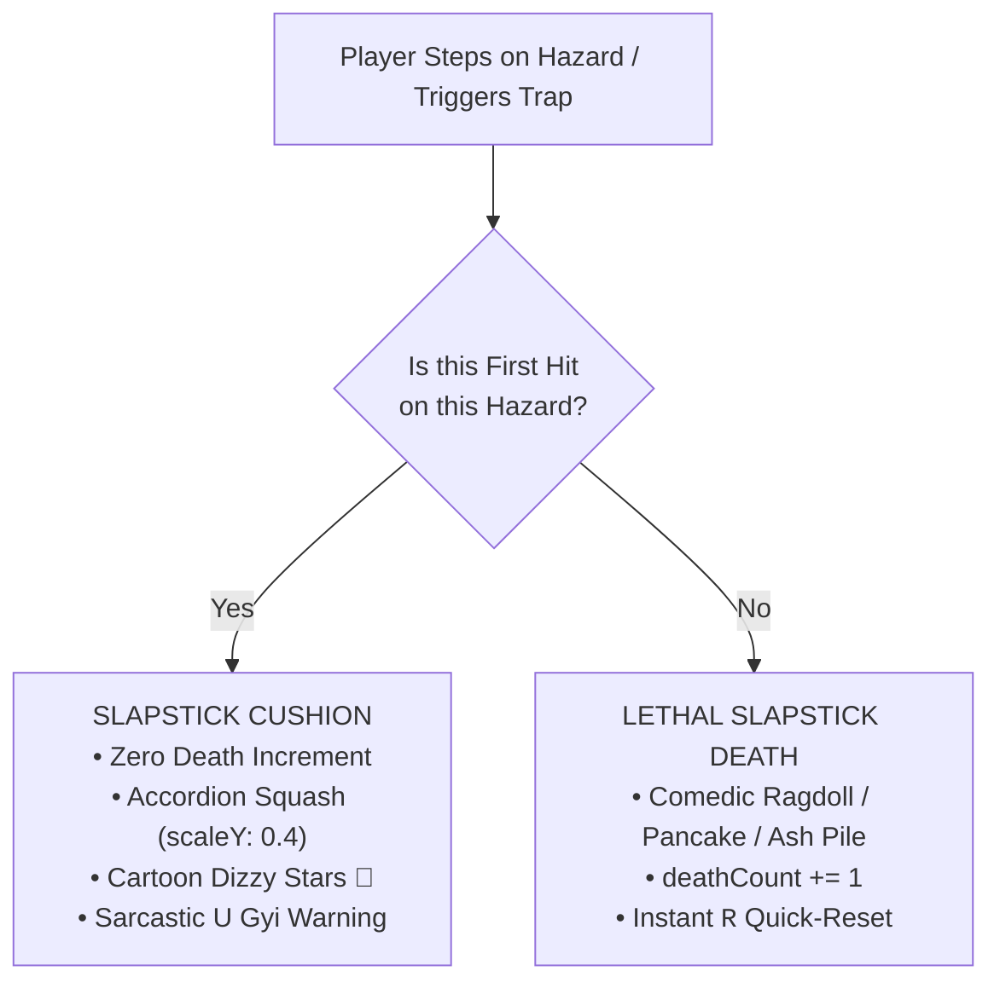

# Puzzle, Trap & Gameplay Mechanics Taxonomy

This document outlines the architectural specifications, spatial invariants, and diegetic crafting rules required for designing traps and puzzles in *Phoe Htaung: Die Again in the Golden City*.

---

## 1. Spatial Geometry & Baseline Invariants

All puzzle chambers operate within a fixed single-screen viewport:
* **Viewport Dimensions:** $1280 \times 720\text{px}$ (16:9 aspect ratio, fixed camera, zero mouse-parallax drift).
* **Universal Walkable Baseline:** `groundY = height * 0.80 = 576px`.
  - All walkable floors, flagstones, bridge planks, and hazard triggers terminate at `y = 576px`.
  - Subterranean base: $y = 576\text{px}$ down to $720\text{px}$ ($144\text{px}$ depth).
* **Domain Physics Hitbox Dimensions:**
  - Upright Standing: Width $36\text{px}$, Height $56\text{px}$ ($[-56, 0]$ from feet).
  - Prone Belly-Crawl (<kbd>S</kbd>): Width $36\text{px}$, Height $25.2\text{px}$ (**55% reduction**, $[-25.2, 0]$ from feet). Speed drops to $40\%$ ($88\text{ px/s}$).
  - Universal Mouth Verb (<kbd>E</kbd>): Interaction circle radius $r = 85\text{px}$ from body center.

---

## 2. Diegetic Shan Bag (*Lwe-Ait*) & In-Bag Crafting System

The traditional Shan shoulder bag (*Lwe-Ait*) is permanently docked at bottom center ($x = 640\text{px}, y = 672\text{px}$). Pressing <kbd>B</kbd>, <kbd>Tab</kbd>, or clicking reveals the 12-slot inventory tray ($y = 596\text{px}$).

### 2.1 Authorized Diegetic Items & Crafting Matrix
In-bag crafting is performed by left-clicking/dragging Item A onto Item B inside the expanded bag dock:

| Item A | Item B | Resulting Crafted Tool | Diegetic Description |
| :--- | :--- | :--- | :--- |
| `betel_cutter` (✂️) | `bamboo_pole` (🎋) | `pointed_stake` (🗡️) | Sharpened bamboo stick for spearing or jamming gear teeth. |
| `betel_cutter` (✂️) | `torn_bottle` (🍾) | `half_bottle` (🍸) | Cut glass funnel / scoop for handling caustic liquids. |
| `betel_cutter` (✂️) | `longyi_strip` (🧣) | `fabric_rope` (🪢) | Tough woven cotton strip used for binding or pulling levers. |
| `fabric_rope` (🪢) | `pointed_stake` (🗡️) | `makeshift_grapple` (🪝) | Reach extension hook for snagging high overhead pulleys. |
| `palm_sap_pot` (🍯) | `river_pebbles` (🪨) | `sticky_ball` (💣) | Adheres to high ceiling buttons or acts as heavy weight. |
| `cheroot_ember` (🚬) | `dried_leaves` (🍂) | `smoke_puff` (💨) | Thick white smoke that exposes invisible laser/dart tripwires. |

### 2.2 The Universal Mouth Verb (<kbd>E</kbd>) Interactions
The mouth verb is Phoe Htaung's iconic physical signature:
1. **Red Betel Nut Spit (*"စွပ်"*):**
   - **Rust Penetrant / Lubricant:** Applied to rusted iron gears (`gear_axle`) to restore rotation.
   - **Blinding Agent:** Spat into the eyes of stone gargoyles, Nat statues, or mechanical watchers to disable detection.
   - **Liquid Balance Counterweight:** Added in small drops to sensitive balance scales.
2. **Taunt / Banter:**
   - Shouting Upper-Burma satirical slang to provoke automated stone crushers or boss mechanisms, causing them to slam down prematurely and expose vulnerable weak spots.

---

## 3. Comedic Trap Architecture & The "Slapstick Cushion"

A key tenet of Phoe Htaung is that death is comedic, never frustrating or unfair.



### 3.1 Slapstick Cushion Guidelines
* **The First Strike is Cartoon:** When an untelegraphed ceiling hazard falls or a rolling pot hits Phoe Htaung for the first time, it does **not** kill him or increment `deathCount`.
* **Visual Presentation:** Phoe Htaung squashes into an accordion (`scaleY: 0.4, scaleX: 1.4`), dizzy cartoon stars spin above his head, and U Gyi barks a hilarious warning:
  > *"ဟိတ်ကောင်! ခေါင်းပေါ် ကြည့်ပါဦး! ကျောက်တုံးတွေ မခိုင်ဘူးဟေ့... နောက်တစ်ခါ ထပ်ကျရင်တော့ ခေါင်းကွဲပြီသာမှတ်!"*
* **The Escalation:** If the player ignores the clear warning and triggers the hazard a second time, it executes a full slapstick death (flattened flat like paper, disintegrating into a comical dust pile, or catapulted off-screen).
* **Fair Telegraphing:** Every trap must offer subtle visual/sound signifiers:
  - Ceiling cracks with periodic falling dust particles.
  - Creaking timber foley 400ms prior to collapse.
  - Distinct stone coloration or loose flagstone depression.

---

## 4. The 4-Route Winning Paradigm

To prevent rigid, brittle scripting and empower creative player problem solving, every single chamber must support 4 distinct winning conditions:

```
┌─────────────────────────────────────────────────────────────────────────────┐
│                       THE 4-ROUTE MULTI-WINNING MATRIX                      │
├──────────────────────────────────┬──────────────────────────────────────────┤
│ 1. CANONICAL MECHANICAL ROUTE    │ • The thematic puzzle chain              │
│    (The Engineer's Way)          │ • Item crafting + environmental assembly │
│                                  │ • Predictable, safe, fully telegraphed   │
├──────────────────────────────────┼──────────────────────────────────────────┤
│ 2. ATHLETIC SPEEDRUN BYPASS      │ • High-skill momentum control            │
│    (The Athlete's Way)           │ • Pole-vaulting over hazards             │
│                                  │ • Frame-tight jump / belly-slide under   │
├──────────────────────────────────┼──────────────────────────────────────────┤
│ 3. SECRET TROLL / "အောက်လမ်း"    │ • Subversion of game rules               │
│    (The Trickster's Way)         │ • Pushing backward into the starting wall│
│                                  │ • Baiting traps to destroy obstacles     │
├──────────────────────────────────┼──────────────────────────────────────────┤
│ 4. MASTER COLLECTOR / RELIC HEIST│ • Snatching optional legendary treasure  │
│    (The Thief's Way)             │ • Disarming or surviving the greed trap  │
│                                  │ • Rewards maximum gold settlement value  │
└──────────────────────────────────┴──────────────────────────────────────────┘
```

### 4.1 Spatial Survival Predicates
Domain completion is never validated by a single boolean flag (e.g. `isDoorOpen == true`). Instead, domain state engines evaluate spatial conditions:
```typescript
// Example Domain Predicate Validation
const isCanonicalWin = state.bridgeLowered && state.x >= 1200 && state.grounded;
const isAthleticWin  = state.vaultedOverChasm && state.x >= 1200 && state.grounded;
const isTrollWin     = state.tunnelOpened && state.x <= 35 && state.grounded;
const isVictorious   = state.alive && (isCanonicalWin || isAthleticWin || isTrollWin);
```
This architectural rule decouples player ingenuity from rigid room scripting.
