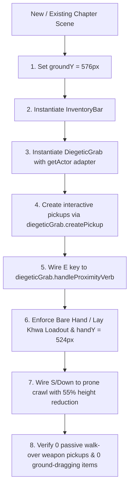

# Phoe Htaung: Character Behaviors, Spatial Geometry & Diegetic Mechanics Specification
## Authoritative Architecture Reference for Game Stabilization

---

## 1. Character Identity & Visual Design Model

### 1.1 Lore & Visual Heritage
* **Name:** Phoe Htaung (ငကြောင်ဖိုးထောင်)
* **Design Philosophy:** Upper Myanmar folklore satire blended with Adolf Lachman's industrial steampunk hand-drawn aesthetic (*Machinarium*).
* **Persona:** A wiry, eccentric Burmese village boy wearing an authentic checkered longyi, Shan shoulder bag (*Lwe-Ait*), and flip-flops. He moves with tactile mechanical inertia, comical over-reactions, and expressive idle behaviors.

### 1.2 Physical Geometry & Hitbox Dimensions
* **Reference Viewport:** Fixed $1280 \times 720\text{px}$ (16:9 aspect ratio, zero mouse-parallax drift).
* **Domain Physics Box:**
  * Width: $36\text{px}$ ($[-18, +18]$ from `centerX`).
  * Standing Height: $56\text{px}$ ($[-56, 0]$ from `feetY`).
  * Prone Belly-Crawl Height: $25.2\text{px}$ (55% reduction, $[-25.2, 0]$ from `feetY`).
* **Phaser Sprite Scale:** Base scale $1.42\times$ (renders high-resolution $850\text{px}$ SVG/PNG vector sprites smoothly to game resolution).

---

## 2. Universal Spatial Geometry & Ground Baseline

```
Canvas Top (y = 0px)
│
│   Head Level (y ≈ 500px)
│   Standing Hand Level: y = 524px (Chest/Waist item holding)
│   Visual Center: y = 536px
│   Shoulder Bag Opening: y = 540px
│   Crouched Reach Hand: y = 546px
├── UNIVERSAL WALKABLE BASELINE: groundY = 576px (0.80 * 720) ───────────────
│   Subterranean Base (Height: 144px down to 720px)
│   Permanent Bottom Shan Bag Dock (Lwe-Ait): x = 52px, y = 668px
Canvas Bottom (y = 720px)
```

### 2.1 The Universal Walkable Ground Baseline (`groundY = 576px`)
* **Strict Invariance:** `groundY = height * 0.80 = 576px` is universal, immutable, and strictly unified across **every chapter and room without exception** (Intro, Chapter 1, Chapter 2, Chapter 3, Chapter 4, Chapter 5, and Arena).
* All walkable platforms, steps, and ground colliders terminate visually at `y = 576px`.

### 2.2 The Domain-to-Visual Coordinate Bridge (`vy`)
In domain-driven simulation rooms (such as Chapter 2), the domain physics engine operates with ground baseline at `C.floor = 640px`. The visual rendering layer translates domain coordinates upward by $64\text{px}$:
$$\Delta Y = \text{VISUAL\_GROUND\_Y} - C.\text{floor} = 576 - 640 = -64\text{px}$$
$$vy(y) = y - 64$$

#### Coordinate Mapping Formula Table
| Feature | Domain Coordinate | Visual Coordinate ($vy$) | Formula / Derivation |
| :--- | :--- | :--- | :--- |
| **Grounded Feet** | `p.feetY = 640px` | `576px` | $vy(p.\text{feetY})$ |
| **Visual Center** | `p.feetY - 40 = 600px` | `536px` | $vy(p.\text{feetY}) - 40$ |
| **Standing Hand** | `p.feetY - 52 = 588px` | `524px` | $vy(p.\text{feetY}) - 52$ |
| **Crouched Reach Hand** | `p.feetY - 30 = 610px` | `546px` | $vy(p.\text{feetY}) - 30$ |
| **Shoulder Bag Mouth** | `p.feetY - 36 = 604px` | `540px` | $vy(p.\text{feetY}) - 36$ |
| **Grab Parabolic Apex** | — | `518px` | $\min(\text{handY}, \text{bagY}) - 22$ |

> [!CAUTION]
> **Subterranean Coordinate Bug Trap:**
> Never pass raw domain coordinates (`p.feetY - 40 = 600px`) directly into sprite tweens or held item positioning. Failing to apply $vy(y) = y - 64$ places the item below ground level ($580\text{px}$), causing the item to drag along the dirt floor at Phoe Htaung's feet!

---

## 3. Comprehensive State & Animation Pipeline

| Posture State | Texture / Animation Key | Physical Hitbox ($w \times h$) | Description & Visual Details |
| :--- | :--- | :--- | :--- |
| **`IDLE`** | `phoe_idle_inhale` / `phoe_idle_exhale` (`ph-idle`) | $36 \times 56\text{px}$ | Continuous organic breathing cycle. Subtle vertical scale oscillation ($1.00 \leftrightarrow 1.04$). |
| **`WALK`** | `phoe_walk` (`ph-walk`) | $36 \times 56\text{px}$ | 8-frame mechanical footstep stride at $220\text{ px/s}$. Directional scale flip (`facing * baseScale`). |
| **`JUMP`** | `phoe_jump` (`ph-jump`) | $36 \times 56\text{px}$ | 5-stage jump cycle (prep stretch, ascent, apex float, fall, landing compression). |
| **`LAYING` (Crawl)** | `phoe_crouch` (`ph-crouch`) | $36 \times 25.2\text{px}$ (**55% reduction**) | Low belly-crawl. Hitbox drops to $25.2\text{px}$ height. Speed drops to $40\%$ ($88\text{ px/s}$). |
| **`PICKUP`** | `phoe_crouch` (`ph-crouch`) | $36 \times 25.2\text{px}$ | Crouched reach toward ground. Hands extend to $(px + \text{facing} \cdot 18, 546\text{px})$. |
| **`RUMMAGE`** | `phoe_bag_rummage` (`ph-bag-rummage`) | $36 \times 56\text{px}$ | Standing upright, hands opening Shan shoulder bag mouth at $(px - \text{facing} \cdot 10, 540\text{px})$. |
| **`HOLD`** | `phoe_hold` | $36 \times 56\text{px}$ | Chest/waist arm extended forward holding equipped item at $y = 524\text{px}$. |
| **`PUSH`** | `phoe_push` | $36 \times 56\text{px}$ | Straining push against heavy rocks or gates. Bodily forward lean ($7^\circ$). |
| **`TAUNT`** | `phoe_taunt` (`ph-laugh`) | $36 \times 56\text{px}$ | Comedic Upper-Burma mouth verb / betel spit banter. Head bob bounce. |
| **`SHOCK` / `DEAD`** | `phoe_shock`, `ph-flat`, `ph-ash`, `ph-dead` | Ragdoll / $0\text{px}$ | Comedic slapstick death animations (flattened pancake, ash pile, bonk stun). |

---

## 4. Locomotion & Prone Belly-Crawl Mechanics

### 4.1 Locomotion & Physics Constants
* **Horizontal Walk:** $220\text{ px/s}$.
* **Jump Velocity:** $-570\text{ px/s}$ vertical impulse.
* **Coyote Time:** $80\text{ms}$ buffer allowing jumps immediately after walking off ledges.
* **Jump Buffer:** $100\text{ms}$ pre-landing input buffer.
* **Gravity Acceleration:** $1700\text{ px/s}^2$.

### 4.2 Prone Belly-Crawl (<kbd>S</kbd> / <kbd>Down</kbd>)
1. **Activation:** Holding <kbd>S</kbd> or <kbd>ArrowDown</kbd> while grounded immediately transitions Phoe Htaung to `p.control = 'LAYING'`.
2. **Dynamic Hitbox Compression:** Hitbox height is instantly reduced by **55%** ($h = 25.2\text{px}$ vs $56\text{px}$), allowing Phoe Htaung to slide beneath low beams, crawl under shelves, and duck underneath falling hazards (e.g. the 40s dropping beehive).
3. **Speed Reduction:** Crawling speed is restricted to **40%** of standard locomotion ($88\text{ px/s}$).
4. **Foley & Particle Audio:**
   * On crawl entry: `soundEngine.playLongyiRustle()`.
   * While crawling horizontally: spawns periodic ground dust puffs via `MicroInteractions.spawnFootstepDust(scene, px, 576, dir)`.
5. **Instant Restoration:** Releasing <kbd>S</kbd> / <kbd>Down</kbd> or pressing <kbd>Space</kbd> immediately restores standing posture and full $56\text{px}$ height.

### 4.3 Norman's Law: Instant Action Canceling
* Locomotion inputs (<kbd>A</kbd>, <kbd>D</kbd>, <kbd>Space</kbd>, <kbd>Left</kbd>, <kbd>Right</kbd>) **instantly cancel** click-to-walk pathfinding, idle special animations, and pending inspection interactions.
* Player agency always overrides scripted walks.

---

## 5. Standardized 3-Phase Diegetic Grab Interaction (`DiegeticGrab.ts`)

```mermaid
sequenceDiagram
    autonumber
    actor Player as Player (Mouse Click / E)
    participant DG as DiegeticGrab.ts
    participant Actor as Phoe Htaung Actor
    participant Item as World Item Sprite
    participant Bag as Shan Bag & InventoryBar

    Player->>DG: Proximity Grab (< 85px)
    Note over DG,Item: Phase 1: Crouch & Reach
    DG->>Actor: setControl('PICKUP') (phoe_crouch)
    DG->>DG: soundEngine.playWoosh()
    DG->>Item: Tween to hand (x: px+18, y: 546px), scale: 0.38 (180ms Back.Out)
    Item-->>DG: Reaches Hand
    DG->>DG: soundEngine.playPickup()

    Note over DG,Item: Phase 2: Open Shoulder Bag & Slide In
    DG->>Actor: setControl('RUMMAGE') (phoe_bag_rummage)
    DG->>DG: soundEngine.playBagRustle()
    DG->>Item: Parabolic Arc via peak (518px) to bag mouth (x: px-10, y: 540px)
    Note over Item: 320ms Cubic.InOut, 180° rot, scale -> 0.08
    Item-->>DG: Enters Bag Mouth
    DG->>DG: MicroInteractions.spawnBagSparkle(px-10, 540)
    DG->>Item: destroy()

    Note over DG,Bag: Phase 3: Proud Bounce & Bag Reveal
    DG->>Actor: setControl('FREE') + proud vertical bounce
    DG->>Bag: Spring-bounce bottom Shan Bag dock (scale: 1.25 -> 1.0)
    DG->>Bag: gameState.addItem() + store.save()
    DG->>Bag: inventoryBar.refresh() & inventoryBar.reveal()
    DG->>Player: U Gyi Voiceover via overhead balloon
    DG->>DG: onBagged() callback
```

### 5.1 Strict Prohibition: Zero Passive Walk-Over Auto-Pickup
* Simply walking or jumping past items (bamboo pole, rusty cog, slingshot, gold pouch) **never** collects them automatically.
* Grabbing requires explicit player intent:
  1. **Direct Mouse Click:** Hovering changes cursor to hand and increases scale to $1.15\times$. Clicking within $85\text{px}$ triggers grab immediately; clicking from farther away auto-walks Phoe Htaung to the item and executes grab upon arrival.
  2. **Proximity Action Verb (<kbd>E</kbd>):** Pressing <kbd>E</kbd> within $85\text{px}$ executes grab on the nearest item.

### 5.2 Phase 1: Crouch & Reach (180ms)
* **Pose:** Phoe Htaung switches to `PICKUP` (`phoe_crouch` / `ph-crouch`).
* **Audio:** `soundEngine.playWoosh()`.
* **Hand Targets:**
  $$handX = \text{actorX} + \text{facing} \cdot 18$$
  $$handY = \text{actorY} + 10 = 536 + 10 = 546\text{px}$$
* **Item Motion:** Tweens to $(handX, handY)$ with `ease: 'Back.Out'` in $180\text{ms}$.
* **Scale Calibration:** Item shrinks down to authentic handheld size `scale: 0.38`.
* **Audio on Hand Contact:** `soundEngine.playPickup()`.

### 5.3 Phase 2: Open Shoulder Bag & Parabolic Arc (320ms)
* **Pose:** Phoe Htaung stands upright and opens his on-body Shan shoulder bag (`RUMMAGE` / `phoe_bag_rummage` / `ph-bag-rummage`).
* **Audio:** `soundEngine.playBagRustle()`.
* **Bag Targets:**
  $$bagTargetX = \text{actorX} - \text{facing} \cdot 10$$
  $$bagTargetY = \text{actorY} + 4 = 536 + 4 = 540\text{px}$$
  $$peakY = \min(handY, bagTargetY) - 22 = 540 - 22 = 518\text{px}$$
* **Parabolic Bézier Motion ($320\text{ms}$, `Cubic.InOut`):**
  $$x(t) = (1-t)^2 handX + 2(1-t)t \frac{handX + bagTargetX}{2} + t^2 bagTargetX$$
  $$y(t) = (1-t)^2 handY + 2(1-t)t \cdot peakY + t^2 bagTargetY$$
  $$angle(t) = t \cdot 180^\circ$$
  $$scale(t) = 0.38 + (0.08 - 0.38)t$$
* **Bag Entry Climax:**
  * Spawns golden sparkle burst `✨` over bag opening: `MicroInteractions.spawnBagSparkle(scene, bagTargetX, bagTargetY)`.
  * Destroys world item sprite.

### 5.4 Phase 3: Proud Bounce, Bag Spring & Inventory Reveal
* **Pose:** Returns to `FREE` / `IDLE`.
* **Proud Vertical Bounce:** Tween scale $scaleY \times 1.08$, $scaleX \times 0.94$ over $120\text{ms}$ with `Back.Out`.
* **Bottom-Dock Shan Bag Spring:** Permanent bottom-dock Shan bag (*Lwe-Ait*) spring-bounces (`scale: 1.25 -> 1.0` in $110\text{ms}$, `Back.Out`).
* **Inventory Tray Reveal:** `inventoryBar.refresh()` and `inventoryBar.reveal()` opens the 12-slot tray upwards to $y = 596\text{px}$.
* **State Persistence:** Calls `gameState.addItem(id)`, `store.campaign.inventory.push(id)`, and `store.save()`.
* **Diegetic Guidance:** Narrative voiceover line delivered strictly via U Gyi's overhead speech balloon (`top: 14%`).
* **Callback:** Fires `config.onBagged()`.

---

## 6. Held Item System & Formalized Loadout Law (`FISTS` vs `SLING`)

When a player selects an item from the inventory bag or pulls it out:

```
        Phoe Htaung Head (y ≈ 500px)
              │
  Hand holding item: (x = p.centerX + facing * 20, y = 524px)
        [Item Sprite: scale = facing * 0.38, 0.38]
              │
        Longyi & Legs (y ≈ 550px)
              │
  Feet / Baseline: y = 576px
```

### 6.1 Handheld Scale & Spatial Anchoring Formula
1. **Scale:** Strictly $0.38$ with directional flipping (`facing * 0.38, 0.38`).
2. **Anchor Position:**
   $$\text{visualFeetY} = vy(p.\text{feetY}) = p.\text{feetY} - 64$$
   $$\text{visualCenterY} = \text{visualFeetY} - 40 = 536\text{px}$$
   $$handX = p.\text{centerX} + p.\text{facing} \cdot 20$$
   $$handY = \text{visualCenterY} - 12 = 524\text{px}$$
3. **Movement Tracking:** In `update()`, `this.heldItemSprite.setPosition(handX, handY)` and `this.heldItemSprite.setScale(p.facing * 0.38, 0.38)`.
4. **Zero Ground Dragging:** Hand height $524\text{px}$ is comfortably $52\text{px}$ above ground baseline ($576\text{px}$). It will **never** drag along the floor.

### 6.2 Formalized Equipment & Grabbing Law: Bare Hands (`လက်ချည်း`) & Lay Khwa (`လေးခွ`) Only
Phoe Htaung's personal capabilities strictly separate **what he can actively wield in combat/action** from **what he can physically grab into his Shan bag**:

| Capability Tier | Allowed Items / Stances | Input & Mechanics |
| :--- | :--- | :--- |
| **1. Active Combat / Hand Loadout** (`ArenaWeapon`) | **Bare Hands (`လက်ချည်း` / `FISTS`)** & **Lay Khwa (`လေးခွ` / `SLING`) ONLY** | Phoe Htaung starts every encounter with **Bare Hands (`လက်ချည်း`)** (`holding: false`, icon: `ch4_vector_bare_hand`). He can shove/punch (<kbd>J</kbd>), push blocks, climb, jump, and belly-crawl. He can **only** switch to **Lay Khwa (`လေးခွ`)** (`holding: true`, icon: `ch2_vector_slingshot`) after he has physically **grabbed** it into his Shan bag (*Lwe-Ait*). |
| **2. Diegetic Grabbing (`DiegeticGrab`)** | **Lay Khwa (`လေးခွ` / `slingshot`)**, **Stones (`ကျောက်ခဲ`)**, & **Chapter Puzzle Props** | Even though Phoe Htaung only fights with **Bare Hands** or **Lay Khwa**, he can physically **grab (<kbd>E</kbd> or Direct Click within $85\text{px}$)** the **Lay Khwa (`လေးခွ`)** in the world to acquire it, grab **stones (`ကျောက်ခဲ`)** from stone piles into his bag to replenish ammo, and grab **puzzle weights/mechanisms** in puzzle rooms to place onto contraptions. |
| **3. Strict Non-Weapon Rule** | Puzzle props (`bamboo_pole`, `rusty_cog`, `stone`, `sandbag`, `crate`, `treasure`, `pin`) | Puzzle objects are grabbed into the Shan bag strictly for puzzle mechanisms (winches, gearboxes, scale pans, latches) and can **never** be equipped as combat weapons. |

---

## 7. Myanmar Traditional Bag (*Lwe-Ait*) & Bottom Dock Architecture

1. **Permanent Docked Position:** Resting at bottom left ($x = 52\text{px}, y = 668\text{px}$, depth: 320).
2. **Shan Hand-Woven Motif:** Deep crimson weave (`0x8b1e28`), geometric cream/gold diamond chevron bands (`0xe9dfbd`/`0xe7bb55`), woven shoulder strap loop, and 8 hanging fringe tassels (ချည်မြိတ်).
3. **Interaction & Toggling:**
   * Clicking the bag icon or pressing <kbd>B</kbd> / <kbd>Tab</kbd> slides the 12-slot inventory tray upward ($y = 596\text{px}$) with fabric rustle audio.
   * Pressing <kbd>B</kbd>, <kbd>Tab</kbd>, or <kbd>Escape</kbd> collapses the tray back into the subterranean base.
   * Hovering scales bag icon by $1.10\times$.
4. **Item Slot Standards:** All items rendered at $44 \times 44\text{px}$.
   * **Bare Hands (`FISTS`):** Uses `ch4_vector_bare_hand` (`item-fists`).
   * **Lay Khwa (`SLING` / `slingshot`):** Uses `ch2_vector_slingshot` / `ch3_icon_slingshot` (`item-slingshot`).
   * **Elongated Tools:** Bamboo pole and iron pin drawn diagonally from $(8, 36)$ to $(36, 8)$.

---

## 8. Cross-Chapter Integration Blueprint & Compliance Checklist

To ensure absolute cross-chapter stability, every room must implement the following checklist:



### 8.1 Actor Adapter Pattern
`DiegeticGrab` requires an actor interface. Use the appropriate adapter:

#### For Domain-Driven Scenes (Chapter 2, Chapter 3 Scale, Chapter 4 Arena):
```typescript
this.diegeticGrab = new DiegeticGrab(this, {
  inventoryBar: this.inventoryBar,
  getActor: () => {
    const p = this.session?.attempt?.player;
    if (!p) return null;
    const visualFeetY = p.feetY - 64; // vy(p.feetY)
    return {
      x: p.centerX,
      y: visualFeetY - 40, // 536px visual center
      facing: p.facing,
      setControl: (ctrl: string) => {
        this.grabControl = ctrl === 'FREE' ? null : (ctrl as 'PICKUP' | 'RUMMAGE');
      },
      bounce: () => {
        const actor = this.view?.getActorSprite();
        if (actor) {
          const baseScale = Math.abs(actor.scaleY || 0.12);
          this.tweens.add({
            targets: actor,
            scaleY: baseScale * 1.08,
            scaleX: p.facing * baseScale * 0.94,
            duration: 120,
            yoyo: true,
            ease: 'Back.Out'
          });
        }
      }
    };
  },
  speak: (text, duration, who) => this.speak(text, duration ?? 2.2, who),
  onAutoWalk: (targetX, onReach) => this.interactWithProximity(targetX, onReach)
});
```

#### For Phaser Arcade Physics Scenes (Chapter 1):
```typescript
this.diegeticGrab = new DiegeticGrab(this, {
  inventoryBar: this.inventoryBar,
  player: this.player,
  speak: (text, duration, who) => this.subtitle.say(text, duration),
  onAutoWalk: (targetX, onReach) => this.interactWithProximity(targetX, onReach)
});
```

---

## 9. Immutable Prohibitions (Zero Tolerance)

1. **NO World-Space Keyboard Shortcuts:** Never display on-screen shortcut strips (e.g. `<kbd>A</kbd><kbd>D</kbd>`, `<kbd>E</kbd>`). Mechanics must be discovered naturally.
2. **NO World-Space Text Stickers / Hint Modals:** U Gyi's overhead balloon (`top: 14%`) is the sole voice and hint vehicle.
3. **NO Passive Walk-Over Pickup:** Phoe Htaung must never vacuum items by walking over them.
4. **NO Dragging Items on Floor:** Held items must never have $y \ge 560\text{px}$.
5. **NO Ground Baseline Drift:** Ground baseline is strictly $576\text{px}$ everywhere.
6. **NO Non-Canonical Combat Weapons:** Phoe Htaung can only equip and fight with **Bare Hands (`လက်ချည်း` / `FISTS`)** or **Lay Khwa (`လေးခွ` / `SLING`)** — never with bamboo poles, cogs, or puzzle weights.
