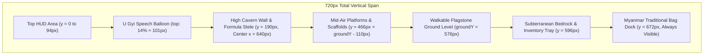

# Core Design System & Stable Mechanics Specification
## Phoe Htaung (ရွှေမြို့တော်ရှာပုံတော်နှင့် ငကြောင်ဖိုးထောင်)

---

## 1. Core Philosophy & Pure Diegetic Rule (The Strict Non-Negotiables)

### 1.1 U Gyi is the Sole Hint & Clue System
* **Strict Ban on World-Space Text Stickers & Labels:**
  * No floating text stickers, labels, or tags are permitted inside the game arena (e.g. `နံရံကြောင်း`, `🚩 CHECKPOINT`, `တံတားစက်`, etc.).
  * No floating hint boxes, modal tip dialogues, or flashing visual arrows.
* **Sole Hint Vehicle (ဦးကြီး - U Gyi):**
  * All gameplay hints, satirical observations, narrative context, and puzzle clues must be delivered **exclusively** through **U Gyi's overhead narrator speech balloon** or his voiceover audio.
  * U Gyi speaks in dynamic speech balloons fixed at `top: 14%` beneath the top HUD (so he never covers Phoe Htaung standing on high platforms).
  * Fast-forward: Tapping <kbd>Space</kbd> or clicking anywhere dismisses dialogue immediately without interrupting player locomotion.

### 1.2 Zero Keyboard Shortcut Display Clutter
* **Strict Ban on On-Screen Shortcut Overlays:**
  * Absolutely no keyboard control banners, key prompts, or shortcut strips are permitted on screen (e.g. `<kbd>A</kbd><kbd>D</kbd> လျှောက်`, `<kbd>SPACE</kbd> ခုန်`, `<kbd>H</kbd> အကူအညီ`, `<kbd>R</kbd> ပြန်စ`).
  * Players must discover controls intuitively through organic spatial design (Miyamoto World 1-1 Rule) and U Gyi's verbal coaching.
  * The bottom UI area (`.game-bottom`) remains clean, minimalist, and uncluttered.

### 1.3 High-End Minimalist Aesthetic (Perplexity $\times$ Machinarium)
* **Visual Typography & Spacing:**
  * High-contrast font-black typography (`font-weight: 900`), generous negative space/whitespace, rounded-[32px] pill containers, and subtle micro-animations.
* **Hand-Inked Procedural Vector Art:**
  * Every game object, platform, hazard, and tool icon is drawn procedurally with crisp hand-inked vector lines.
  * **3-Layer Tactile Inking Formula:**
    $$\text{Outer INK Outline (1-2px)} \xrightarrow{\text{Base Material Fill}} \text{Top CREAM Bevel Highlight (2-4px)} \xrightarrow{\text{Bottom Shadow Bevel}}$$
  * No low-resolution pixel scaling or blurred raster stretching.

---

## 2. Spatial Geometry & Coordinate System

To ensure seamless character movement across all chapters and avoid visual or physical glitches:

| Constant | Value | Description |
| :--- | :--- | :--- |
| **Canvas Width** | `1280px` | Standard 16:9 widescreen horizontal resolution. |
| **Canvas Height** | `720px` | Standard 16:9 widescreen vertical resolution. |
| **Walkable Ground Level (`groundY`)** | `576px` ($720 \times 0.80$) | **The Untouchable Universal Baseline.** Phoe Htaung walks on this exact $y$-coordinate across every single chapter (Chapter 1, 2, 3, 4, 5, and Intro) without exception. |
| **Camera Viewport** | Fixed $1280 \times 720$ | Static camera with zero parallax drift, zero breathing motion, and zero camera jitter. |
| **HUD Height Boundary** | $y \le 94\text{px}$ | The top HUD title and ledger occupy $y = 0 \dots 94\text{px}$. Interactive puzzle elements must maintain clearance below $y \ge 170\text{px}$. |



---

## 3. Procedural Color & Vector Inking Tokens

All procedural textures generated in `BridgeView.ts` and scene view layers must strictly utilize these color constants:

```typescript
export const INK        = 0x182720; // Deep dark outline border
export const CREAM      = 0xe9dfbd; // Top specular highlight & chalk etchings
export const GOLD       = 0xe7bb55; // Brass gears, rivets, aura glows, active borders
export const METAL      = 0x839b8b; // Cold wrought iron & mechanisms
export const WOOD       = 0x9d7047; // Timber beams, planks, scaffolds
export const STONE      = 0x3b4b3d; // Deep subterranean bedrock & bottom shadow bevels
export const STEP_STONE = 0x6e7c66; // Walkable stone platforms & formula steles
export const SHAN_RED   = 0x8b1e28; // Myanmar traditional bag crimson weave
export const SHAN_DARK  = 0x5a1219; // Traditional bag weave shadow tone
export const BETEL_RED  = 0x9b111e; // Betel nut juice droplet body
export const BETEL_DARK = 0x5a0808; // Betel nut droplet shadow core
export const ROPE       = 0xc4a364; // Hemp fiber ropes & tied knots
export const ROPE_DARK  = 0x8c6d3b; // Hemp shadow fibers
```

---

## 4. Myanmar Traditional Bag (*Lwe-Ait*) & Bottom Inventory Dock Standards

The player's inventory is anchored permanently at the bottom of the screen as an authentic Myanmar traditional shoulder bag:

* **Permanent Visibility & Docking:**
  * Sits centered at $x = 640\text{px}$, $y = 672\text{px}$ in the subterranean base below the walkable floor.
  * Always visible across all chapters and rooms; never completely hides off-screen.
  * Diegetic design: Woven crimson body (`SHAN_RED`), cream/gold geometric chevron bands, draped shoulder strap, and 8 dangling yarn fringe tassels.
* **Tray Unfolding & Keyboard Shortcut:**
  * **Click Trigger:** Left-clicking the bag or pill badge `🎒 လွယ်အိတ်` smoothly expands the 12-slot inventory tray upward to $y = 596\text{px}$ (just above the bag, beneath `groundY = 576px`).
  * **Shortcut Key:** Pressing <kbd>B</kbd> or <kbd>Tab</kbd> instantly toggles the inventory tray open and closed.
  * **Close Action:** Clicking the bag again, pressing <kbd>B</kbd>/<kbd>Escape</kbd>, or clicking outside closes the tray.
  * **Audio:** Plays `soundEngine.playBagRustle()` on reveal and hide.
* **Slot Matrix & Styling:**
  * 12 slots arranged horizontally in an elegant rounded-[32px] container.
  * Inactive Slot: Deep slate `#182720` with subtle `#22352b` fill.
  * Active Selected Slot: Vibrant gold outline `#e7bb55`, glass reflection bevel, and equipped tool in Phoe Htaung's hand sprite.
* **In-Bag Combination (Crafting):**
  * Selecting Item $A$ and left-clicking Item $B$ checks the combination table (e.g. `betel_cutter` + `torn_bottle` $\rightarrow$ `half_bottle`) with dedicated crafting foley (`playScissors()`).
* **Universal Consistency:**
  * Sourced from Chapter 1 as the single authoritative `InventoryBar` component used identically across all rooms.

---

## 5. Item Vector Art & Icon Standards

To ensure every collected tool looks sharp and legible inside square inventory slots and on the ground:

* **Standard Canvas Resolution:** All item textures are rendered at **$44 \times 44\text{px}$**.
* **Diagonal Alignment for Elongated Tools:**
  * Any long tool (such as `bamboo_pole`, crowbars, or fishing rods) must be drawn diagonally from bottom-left $(8, 36)$ to top-right $(36, 8)$ with 3 nodes. This prevents clipping or unnatural microscopic scaling inside square slots.
* **Active Ground Pickups:**
  * When dropped on the floor, ground pickups sit at $y = \text{groundY} - 14\text{px}$ with a subtle Chapter 2 idle bob tween:
    $$y(t) = (\text{groundY} - 14) + \sin(3t) \times 2\text{px}$$
  * Emits a soft ambient gold glow (`GOLD`, alpha 0.15, radius 28px).
  * Hovering scales by $1.15 \times$ with pointer hand cursor.

---

## 6. Phoe Htaung Physics & Controls Baseline

Every chapter must inherit these exact physical constants to maintain consistent player locomotion feel:

| Action / Verb | Key / Input | Physics Specification |
| :--- | :--- | :--- |
| **Horizontal Locomotion** | <kbd>A</kbd> / <kbd>D</kbd> or Left/Right | Constant $220\text{ px/s}$ walk speed. Synchronized flip-flop footstep foley (`playStep()`). |
| **Vertical Jump** | <kbd>Space</kbd> / <kbd>W</kbd> / <kbd>↑</kbd> | Vertical impulse $-570\text{ px/s}$. Gravity: $1100\text{ px/s}^2$. 80ms coyote time and 100ms jump buffer. |
| **Prone Belly-Crawl** | <kbd>S</kbd> / <kbd>↓</kbd> (Hold) | Hitbox height reduced by $55\%$ ($72\text{px} \rightarrow 32\text{px}$), speed at $40\%$ ($88\text{ px/s}$). Slides under low stone beams and submerges in mud patches. |
| **Universal Mouth Verb** | <kbd>E</kbd> | Proximity radius $d \le 85\text{px}$. Contextual: Spits betel juice, lubricates rusty gears, taunts machinery/enemies. |
| **Instant Action Canceling** | <kbd>Space</kbd> / <kbd>A</kbd> / <kbd>D</kbd> | **Norman's Law:** Pressing jump or locomotion instantly aborts any automated walking, item inspection, or crafting animation. |
| **Instant Quick-Reset** | <kbd>R</kbd> (Hold 0.5s) | Instantly restores chamber spawn snapshot in $<16\text{ms}$ without reloading the browser page. |

---

## 7. Diegetic Dialogue & Reset Protocol

* **Asynchronous Narrator Bus:**
  * U Gyi's comedic voiceover plays over a dedicated ducked audio bus.
  * Phoe Htaung is already running on Attempt #2 while U Gyi is still delivering the roast from Attempt #1.
  * Rapid death interruption: If Phoe Htaung dies again within 1.5s, U Gyi cuts himself off with an instantaneous comedic interjection (*"အယ်!"*, *"သေပြန်ပြီလား!"*).
* **Sub-200ms Instant Snapshot Respawn:**
  * Lethal contact triggers a 120ms camera micro-shake, instant death state sound, and sub-200ms respawn.
* **Comedic Ghost Marks:**
  * Faint cartoon chalk outlines and red betel spit splatters remain permanently stamped on the ground where Phoe Htaung died (`setDepth(14)`), creating a humorous visual history of failed attempts.

---

## 8. Multi-Winning-Condition Domain Contract

Every chapter must implement multiple winning conditions (Canonical, Athletic Bypass, Secret "အောက်လမ်း", Master Heist). The domain engine validates room progression using the following predicate contract:

```typescript
export interface RoomExit {
  alive: boolean;
  grounded: boolean;
  x: number;
  feetY: number;
  groundY: number;
  width: number;
  tunnelOpened: boolean;
  athleticBypass?: boolean;
}

export function roomExit(s: RoomExit): boolean {
  return (
    s.alive &&
    s.grounded &&
    Math.abs(s.feetY - s.groundY) <= 1 &&
    ((s.x >= s.width * 0.78) || (s.tunnelOpened && s.x <= 35) || Boolean(s.athleticBypass))
  );
}
```
* **Decoupled Architecture:** Room progression evaluates player survival and physical coordinates rather than a brittle single-purpose boolean flag.
