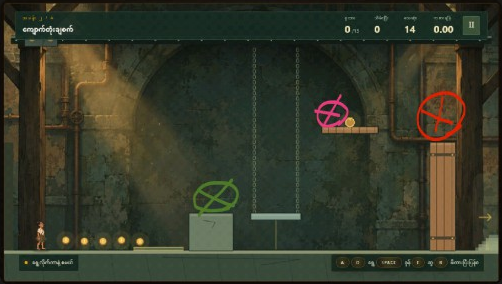
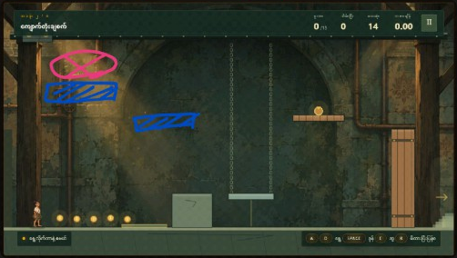
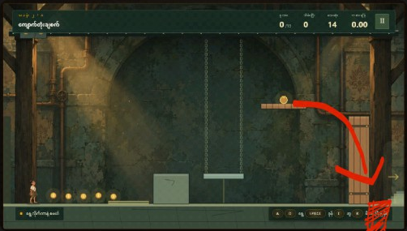

# ဖိုးထောင် (ပုဂံရွှေမြို့တော် စွန့်စားခန်း) — Chapter 1 & 2 Feedback and Requirements

## Chapter-1

* **Obstacle Delays & Animations:**
  * အပေါ်က ကျလာတဲ့ obstacle နှစ်ခုဖြစ်တဲ့ ကျောက်တုံးနှင့် ပျားအုံကို delay လုပ်ရန်။
  * ပြီးလျှင် Game Over ဖြစ်သွားသည့်အခါ defeat animation တစ်ခု ထည့်သွင်းရန်။
  * **Purpose:** Player ကို ရလာတဲ့ equipments တွေကို အသုံးပြုပြီး mechanic တစ်ခုကို ဖြေရှင်းစေရန်နှင့် မထင်မှတ်ထားတဲ့ obstacle ကို တွေ့ကြုံစေရန်။

* **Clue Removal & Atmospheric Cleanup:**
  * နံရံကြောင်း၊ တွင်းကိုသတိထား၊ ပစ္စည်းကောက်ပြီးမှ စက်သီးမှာသုံးပါ၊ `A` `D` ရွေ့ `SPACE` ခုန် စသော clue များကို ဖျောက်ရန်။
  * **Purpose:** Game display ကို player အမြင်တွင် ချောမွေ့မှုရှိစေရန်၊ clue giver ကို ဦးကြီး (U Gyi) narrator တစ်ဦးတည်းသာ ဖြစ်စေရန်၊ ပြီးလျှင် player ကို clue များများမပေးထားဘဲ လမ်းကြောင်းလွဲကာ အဖြေကို စဉ်းစားတွေးခေါ်ပြီး ရှာစေရန်။

* **Inventory UI Cleanliness:**
  * လွယ်အိတ် button နှစ်ခု ဖြစ်နေသည်၊ လွယ်အိတ် button အစား လွယ်အိတ်ပုံစံ icon သာ အသုံးပြုရန်။

* **Smooth Chapter Transition:**
  * Chapter တစ်ခုနှင့်တစ်ခု smooth transition ဖြစ်စေရန် chapter တစ်ခု အောင်မြင်ပြီးတိုင်း ထွက်လာမည့် menu ကို ဖျောက်ရန်။
  * **Transition ဥပမာ:** Chapter 1 အောင်မြင်ပြီးသော ဖိုးထောင်သည် နံရံကြောင်းကို ဖြတ်ပြီးသည်နှင့် Chapter 2 ဆီသို့ တိုက်ရိုက် နံရံကြောင်းမှ ကူးပြောင်းသွားမည်။ ထို့ကြောင့် Chapter 2 အစတွင် ဖိုးထောင် နံရံကြောင်းမှ ထွက်လာသည့်ပုံစံ animation လိုအပ်သည်။

---

## Chapter-2

### 1. Visual Trajectory & Clue Strip-down
* **Trajectory Indicators:**
  * ကျောက်တုံးချစက်တွင် ကျောက်တုံးမချမီ ထွက်လာသော လိမ္မော်ရောင် လမ်းကြောင်းများနှင့် ကျောက်တုံးကျလာမည့် လမ်းကြောင်း visual များကို ဖျောက်ရန်။
  * **Purpose:** Player ကို ကျောက်တုံးကျလာမည့် အချိန်နှင့် ကျလာနိုင်သည့်နေရာကို မိမိဖာသာ တွေးခေါ်စေရန်။
* **Status Bars & Prompt Cleanup:**
  * ကျောက်တုံးချစက်မှ ကျလာသည့် စာတန်း (50kg) ကို ဖျောက်ရန်။
  * အောက်တွင် ဖော်ပြထားသော status များ (ကျောက်တုံးကျနေသည်၊ အချက်ပြရပ်နေသည်ရှောင်၊ Interact လုပ်လို့ရပြီ စသော status bar) ကို ဖျောက်ရန်။
  * `A` `D` ရွေ့ `SPACE` ခုန် စသော clue များကို ဖျောက်ရန်။
  * Chapter 2 တွင် လွယ်အိတ် icon မပါသေးသဖြင့် ထည့်ရန်။

---

### 2. Puzzle & Gear Mechanism (အကြံပြုချက်)

* **ပစ္စည်းများ နေရာချထားမှု:**
  * **အနီရောင်ဝိုင်းထားသောနေရာ:** Chapter 1 ကဲ့သို့သော **ဂီယာ box** (တံခါးပေါ်တွင်)
  * **အစိမ်းရောင်ဝိုင်းထားသောနေရာ:** Chapter 1 ကဲ့သို့သော **ဝါးလုံး (bamboo pole)**
  * **ပန်းရောင်ဝိုင်းထားသောနေရာ:** Chapter 1 ကဲ့သို့သော **ဂီယာခွေ (gear wheel)**
* **မက္ကနစ်:**
  * ဂီယာခွေနှင့် ဝါးလုံးကို Chapter 1 ကဲ့သို့ စုဆောင်းပြီး တံခါးပေါ်ရှိ ဂီယာ box တွင် တပ်ဆင်၍ activate လုပ်ရန်။

---

### 3. Platforms, Slingshot Relic & Beehive Timer

* **စင်များ ပေါ်လာခြင်း (Platforms):**
  * ဂီယာ box ကို activate လုပ်ပြီးသည်နှင့် ပုံတွင် ပြထားသည့်အတိုင်း စင် (platform) နှစ်ခု ပေါ်လာမည်။
* **Chapter 4 Weapon Reward (လေးခွနှင့် လောက်စာလုံး):**
  * အပေါ်ဆုံးစင်အပေါ် ပန်းရောင်ဝိုင်းထားသည့်နေရာတွင် Chapter 4 အတွက် အဓိက လိုအပ်မည့် **လေးခွနှင့် လောက်စာလုံးတစ်ချို့ (slingshot & ammo)** ကို ရရှိမည်။
* **40s Beehive Panic Hazard (ပျားအုံ):**
  * Player သည် Chapter 2 တွင် ကစားချိန် 40 seconds ကျော်သည်နှင့် Chapter 1 မှာကဲ့သို့ ပျားအုံသည် player ဆီသို့ ကျလာမည်။

---

### 4. Surprise Exit Trap (Die Again Style) & Seamless Transition

* **Surprise Floor/Pit Trap:**
  * နောက်ဆုံးအနေဖြင့် player သည် တံခါးကို ဖွင့်၍ နောက်တစ်ဆင့်သို့ တက်မည့်နေရာတွင် ပုံတွင် ပြထားသည့် အနီရောင်ခြယ်ထားသော နေရာ၌ *Die Again* game ထဲကလိုမျိုး floor obstacle သို့မဟုတ် တွင်းပေါက် trap တစ်ခု မထင်မှတ်ထားဘဲ ပေါ်လာမည် (player ကို အငိုက်မိစေလိုသော ရည်ရွယ်ချက်)။
* **Smooth Chapter 3 Transition:**
  * Chapter 2 အောင်မြင်ပြီးတိုင်း ထွက်လာမည့် menu/result card ကို ဖျောက်ရန်။
  * တံခါးပွင့်ပြီး နောက် chapter သို့ ချောချောမွေ့မွေ့ direct transition ကူးပြောင်းစေရန်။
