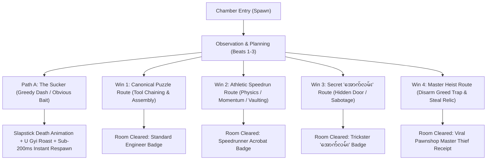

# Game Mechanics & Architecture Specification: Phoe Htaung
## (ရွှေမြို့တော်ရှာပုံတော်နှင့် ငကြောင်ဖိုးထောင်)

---

## 1. Executive Vision & Core Gameplay Formula

* **Title:** ရွှေမြို့တော်ရှာပုံတော်နှင့် ငကြောင်ဖိုးထောင် (*Phoe Htaung: Die Again in the Golden City*)
* **Genre:** 2D Point-and-Click / Troll Puzzle-Platformer (*Die Again* $\times$ *Machinarium* $\times$ Upper Myanmar Folklore Satire)
* **Core Philosophy:** **Mild Action Pressure + Creative Tool Problem-Solving + Comedic Troll Traps**.
* **The Gameplay Loop:**
  $$\text{Observe Arena (Single Screen)} \xrightarrow{\text{Plan (Safe Beat)}} \text{Execute under Mild Pressure} \xrightarrow{\text{Hilarious Slapstick Death / Troll Victory}} \text{Instant Respawn / Next Room}$$

### 1.1 The Multi-Winning-Condition Paradigm (The Universal Standard)

A foundational architectural rule of *Phoe Htaung* is that **no room or puzzle chamber should ever have only a single rigid way to win**. Every single chapter supports multiple distinct, fully validated winning pathways:

1. **Winning Condition 1: The Canonical Mechanical Route (The Engineer's Way):**
   - The thematic, multi-step tool discovery, in-bag crafting, and environmental assembly route.
   - *Chapter 1 (Bridge):* Assembling the winch, lubricating with betel spit, and lowering the drawbridge.
   - *Chapter 2 (Stone Crusher):* Baiting stone drop onto the pressure plate ($x=336$), raising the lift ($x=640$), traversing upper shelves, and safely reaching the high exit.
2. **Winning Condition 2: The Athletic / Speedrun Bypass Win (The Athlete's Way):**
   - High-skill platforming, physics exploitation, momentum conservation, or athletic tool vaulting that skips major puzzle steps cleanly.
   - *Chapter 1 (Bridge):* Sprint pole-vaulting clean across the 192px pit chasm with the bamboo stick.
   - *Chapter 2 (Stone Crusher):* Baiting the machine to drop a 50kg boulder directly onto the wooden gate ($x=1104$), smashing it to splinters, and sprinting through ground exit without touching the lift.
3. **Winning Condition 3: The Secret Troll / "အောက်လမ်း" Alternate Win (The Trickster's Way):**
   - Unorthodox lateral thinking, environmental sabotage, or hidden backwards passages subverting expected game logic.
   - *Chapter 1 (Bridge):* Pushing against the starting left wall for 1.0s to reveal the secret dungeon door and exit left.
   - *Chapter 2 (Stone Crusher):* Stacking multiple dropped stones to shatter them into rubble, or near-miss taunting (<kbd>E</kbd>) to exploit machine recoil and bypass obstacles.
4. **Winning Condition 4: The Master Collector / Relic Heist Win (The Thief's Way):**
   - Snatching optional legendary chapter treasures, disarming or outsmarting deadly greed traps, and escaping with full loot for maximum settlement appraisal.
   - *Chapter 1 (Bridge):* Outsmarting the string-pulled coin yoink trap and escaping with the ancient relic.
   - *Chapter 2 (Stone Crusher):* Collecting all 5 floor coins ($160\text{–}352$), demolishing the shelf to drop the gold pouch ($+10$), and escaping with full 15/15 gold.

> [!IMPORTANT]
> **Domain Architecture Contract:** The domain engine validates room completion using spatial survival predicates (e.g. `s.alive && s.grounded && ...`) and alternate route predicates (e.g. `s.tunnelOpened && s.x <= 35` or athletic threshold coordinates), rather than checking a single monolithic puzzle-step boolean flag. This decouples player ingenuity from rigid, brittle scripting.

---

## 2. Core Control Schema & Ergonomics

To completely eliminate friction between fast-paced platforming and deliberate point-and-click tool selection, inputs are strictly orthogonal, tactile, and unified:

| Verb | Primary Key | Secondary / Mouse | Behavioral Specification |
| :--- | :--- | :--- | :--- |
| **Locomotion** | <kbd>A</kbd> / <kbd>D</kbd> | Left / Right Arrows or Floor Click | 220 px/s horizontal walk with synchronized flip-flop footstep foley. |
| **Jump** | <kbd>Space</kbd> / <kbd>W</kbd> | Up Arrow | -570 px/s vertical impulse. Includes 80ms coyote time and 100ms jump buffering. |
| **Belly-Crawl** | <kbd>S</kbd> / <kbd>↓</kbd> (Hold) | — | Drops Phoe Htaung into a prone belly-crawl (hitbox height reduced by 55%, speed at 40%). Slides under low beams and submerges in mud. |
| **Universal "Mouth Verb"** | <kbd>E</kbd> | Contextual UI prompt | **Unified Agency:**<br>• *Ambient:* Spits red betel nut juice (*"စွပ်"*).<br>• *Machinery:* Acts as emergency lubricant ("ဆေးမြီးတို") for rusty gears.<br>• *Hazards / Machine:* Provokes/taunts machines or enemies with Upper-Burma banter.<br>• *Tool in Hand:* If standing within proximity ($d \le 85\text{px}$) of an active target with an item held, applies the item. |
| **Myanmar Traditional Bag Dock (Lwe-Ait)** | Click Bag Dock / <kbd>B</kbd> / <kbd>Tab</kbd> | Click `🎒` in HUD | Permanently visible at bottom center ($x=640\text{px}, y=672\text{px}$). Expands upward to $y=596\text{px}$ to reveal 12 item slots with tactile fabric rustle audio. |
| **Slot Selection / Held Item** | <kbd>1</kbd>, <kbd>2</kbd>, <kbd>3</kbd> | Left-Click Slot | Instantly equips tool into Phoe Htaung's hand sprite. Clicking the active slot a second time deselects it and clears hands. |
| **In-Bag Tool Crafting** | Left-Click Slot $B$ while holding $A$ | Drag & Drop | Evaluates crafting recipe (e.g. `betel_cutter` + `torn_bottle` $\rightarrow$ `half_bottle`) with dedicated crafting audio. |
| **Contextual Tool Application** | <kbd>E</kbd> or Left-Click Target | Proximity Click ($d \le 85\text{px}$) | Applies held tool to world prop. If no tool is held, triggers tactile bare-handed inspection or narrator hint. |
| **Instant Action Canceling** | <kbd>Space</kbd> / <kbd>A</kbd> / <kbd>D</kbd> | — | **Norman's Law:** Any ongoing item inspection, pickup, or crafting animation is immediately aborted if the player inputs a jump or dodge. |
| **Instant Quick-Reset** | <kbd>R</kbd> (Hold 0.5s) | — | Instantly resets the current room state without reloading the page or losing persistent campaign statistics. |

---

## 3. First-Time User Experience (FTUE) & Onboarding Architecture

### 3.1 The First 30 Seconds: Instant Agency ($T = 0\text{s}$)
* **Zero Input Gating:** Players never sit through 11+ seconds of passive text typing. Phoe Htaung is controllable immediately upon scene entry.
* **Non-Blocking Dialogue:** U Gyi's satirical opening voiceover plays overhead in dynamic speech balloons while Phoe Htaung is already free to run, jump, and test controls.
* **Dialogue Fast-Forward:** Tapping <kbd>Space</kbd> or clicking skips dialogue lines instantly.

### 3.2 The Micro-Tutorial Without Text Walls (Miyamoto World 1-1 Rule)
The opening chamber naturally teaches all game mechanics through spatial geometry:
1. **Rightward Pull (0–3s):** Camera framing with negative space to the right instinctively pulls the player rightward using <kbd>D</kbd>.
2. **Belly-Crawl Discovery (<kbd>S</kbd>) (4–8s):** A low ancient stone archway ($y=590$) harmlessly blocks upright walking (*Thunk!*). Phoe Htaung stoops his neck while U Gyi shouts down-to-earth advice (*"ကုန်းလျှောက်လေ ငကြောင်ရ... ခေါင်းစိုက်ပြီး တွားသွားစမ်း!"*). Pressing <kbd>S</kbd> executes the belly crawl under the beam without artificial visual thought clouds.
3. **Low-Stakes Jump (9–14s):** A small 40px crack in the flagstones (not a death pit). Stepping into it causes a harmless comic stumble; <kbd>Space</kbd> clears it smoothly.
4. **Tactile Bag Feedback & Starting Tool:** Phoe Htaung enters with his signature heirloom tool already in his shoulder bag (*Lwe-Ait*): the **Betel Nut Cutter** (`betel_cutter` ✂️). When collecting chained tools (`bamboo_pole`, `rusty_cog`), Phoe Htaung physically secures them into his bag with a tactile fabric rustle (*Schrrrrt!*), accompanied by slot illumination on the top HUD dock.

### 3.3 The Slapstick Cushion ("First Hit is Cartoon, Not Death")
* When the first ambient ceiling hazard drops, it does **not** increment `deathCount` or kill Phoe Htaung.
* Instead, it triggers an accordion squash animation (`scaleY: 0.4`), spinning dizzy cartoon stars (`💫`), and U Gyi shouting:
  > *"ဟိတ်ကောင်! ခေါင်းပေါ် ကြည့်ပါဦး! ကျောက်တုံးတွေ မခိုင်ဘူးဟေ့... နောက်တစ်ခါ ထပ်ကျရင်တော့ ခေါင်းကွဲပြီသာမှတ်!"*
* The hazard timer only begins after Phoe Htaung has moved at least 150px into the room.

---

## 4. The Diegetic Item & Inventory Architecture (The "Snip, Pry & Lubricate" System)

### 4.1 The Permanent Bottom-Docked Myanmar Traditional Bag (*Lwe-Ait*) & 12-Slot Tray
To keep the player immersed in the atmospheric ruins while ensuring immediate, reliable inventory access across all chapters:
* **Permanent Bottom Docking & Reveal Mechanics:**
  - **Permanent Docked Visibility:** Resting in the subterranean base at $x = 640\text{px}$, $y = 672\text{px}$ (Depth: 320), the authentic hand-woven Shan crimson textile bag (*လွယ်အိတ်*) remains permanently visible across all chapters.
  - **Active Drawer Reveal:** Toggling the bag (via clicking the bottom dock, clicking the HUD `🎒` button, or pressing shortcut keys <kbd>B</kbd> / <kbd>Tab</kbd>) smoothly expands the 12-slot inventory tray upward from $y = 760\text{px}$ to $y = 596\text{px}$ (`Back.Out`, 240ms) with authentic fabric rustle foley.
  - **Dismissal & Action Canceling:** Clicking the bag again, pressing <kbd>B</kbd>, <kbd>Tab</kbd>, or <kbd>Escape</kbd>, or inputting locomotion (<kbd>A</kbd>, <kbd>D</kbd>, <kbd>Space</kbd>) instantly collapses the tray back into the bag.
  - **Universal Component:** Sourced from Chapter 1 as the authoritative, shared `InventoryBar` across every chapter.
* **Slot Matrix & Minimalist Aesthetic:**
  - 12 slots styled with deep ink (`#182720`), moss-slate (`#22352b`), and warm gold brass rims (`#e7bb55`).
  - Active Slot Highlight: The selected slot illuminates with a vibrant gold border and specular glass bevel.
  - Tooltip: Hovering any item displays its authentic Burmese title (e.g. *"ကွမ်းသီးညှပ်"*, *"ဝါးလုံးတုတ်"*, *"ဂီယာခွေဟောင်း"*) styled in high-contrast Noto Sans Myanmar.

### 4.2 The Held-Item Visual State & Direct Selection
* **Direct Selection (<kbd>1</kbd>–<kbd>3</kbd> or Slot Click):**
  - Pressing keyboard numbers <kbd>1</kbd>–<kbd>3</kbd> or clicking a slot equips the item into Phoe Htaung's hand sprite.
  - Clicking the currently equipped slot toggles deselection, returning tools safely to the bag.
* **Held Sprite Visualization:**
  - Phoe Htaung visually carries the equipped tool in hand, providing clear visual confirmation of intent.
  - The HUD tooltip locks to `"ကိုင်ထားသည်: [Item Name]"`.
* **Inspectable Blueprints:**
  - Selecting narrative items like the Ancient Engineer's Blueprint (`engineer_note`) displays a full-screen hand-drawn parchment/chalk architectural diagram illustrating puzzle schematics.

### 4.3 In-Bag Combination Mechanics (Tactile Crafting)
* Players can combine complementary tools directly within the shoulder bag.
* **Interaction:** With item $A$ currently selected in the inventory, clicking slot $B$ checks the combination matrix:
  $$\text{Item } A + \text{Item } B \longrightarrow \text{Crafted Item } C$$
* **Current Combinations:**
  | Ingredient 1 | Ingredient 2 | Result | Foley / Sound | Contextual Result |
  | :--- | :--- | :--- | :--- | :--- |
  | `betel_cutter` (✂️ ကွမ်းသီးညှပ်) | `torn_bottle` (🧴 ရေဗူးစုတ်) | `half_bottle` (ရေဗူးခြမ်း) | `soundEngine.playScissors()` | Snips plastic bottle into a protective nozzle cowl. |

### 4.4 The 4-Beat Environmental Tool Chaining Loop ("Snip, Pry & Lubricate")
Room progression replaces gamey keys and bare pickups with an organic, physical tool-chaining sequence:

```
[ PHOE HTAUNG'S SHOULDER BAG ]
         │
Starts with heirloom tool:
[ ITEM 1: BETEL CUTTER ] ✂️
         │
         │ (1. SNIP) Apply to hemp rope knot on scaffold
         ▼
[ ITEM 2: BAMBOO POLE ] 🎋
         │
         │ (2. PRY) Use as crowbar on fallen rock crevice
         ▼
[ ITEM 3: RUSTY COG ] ⚙️
         │
         │ (3. ASSEMBLE) Slot Cog & Bamboo Pole into Winch ports
         ▼
[ WINCH MECHANISM (JAMMED) ]
         │
         │ (4. LUBRICATE) Press 'E' near winch (Universal Mouth Verb)
         ▼
[ RED BETEL SPIT (*"စွပ်"*) LUBRICATES GEARS ] 🩸
         │
         ▼
🎯 DRAWBRIDGE UNLATCHES & DROPS SAFELY!
```

1. **Beat 1: The Snip (Scissors vs Rope):**
   - **Interactive Target:** Bamboo pole lashed to ancient timber scaffolding with a coiled hemp knot.
   - **Action:** Equipping `betel_cutter` and clicking the knot snips the hemp fibers (`playScissors()`). Severed rope coils drop, and the `bamboo_pole` slides down into Phoe Htaung's shoulder bag.
2. **Beat 2: The Pry (Lever vs Stone):**
   - **Interactive Target:** Heavy fallen step-stone wedged over an ancient bronze cog.
   - **Action:** Equipping `bamboo_pole` and clicking the crevice wedges the pole at $38^\circ$. Phoe Htaung leans with dynamic weight recoil (`scaleY: 0.85`), puffs dust, and heaves the boulder up with a grinding stone scrape (`playStoneGrind()`). The `rusty_cog` launches free in a high parabolic trajectory and clatters into the bag.
3. **Beat 3: The Assembly (Parts into Chassis):**
   - **Interactive Target:** Cliffside Winch chassis missing drive components.
   - **Action:** Inserting the `rusty_cog` and `bamboo_pole` mounts them into the brass axle. The gears engage with a metallic lock, but remain immobilized by decades of orange corrosion (`winchJammed = true`).
4. **Beat 4: The Lubrication (Emergency Folk Remedy):**
   - **Interactive Target:** Jammed winch axle.
   - **Action:** Stepping into proximity ($d \le 85\text{px}$) and pressing the Universal Mouth Verb <kbd>E</kbd> spits a droplet of dark red betel nut juice directly into the gear teeth (`playSpit()`). The spit dissolves the rust, sparking a golden brass gleam (`0xe7bb55`), unjamming the gears (`winchLubricated = true`), and triggering the counterweighted bridge drop.

### 4.5 The Zero-Thought-Bubble Narrative Protocol
* **Strict Ban on Comic Floating Bubbles:** Floating cloud bubbles, rising trail dots, and overhead thought icons are strictly prohibited across all game chapters.
* **Direct Diegetic Narrator Dialogue:**
  - All environmental hints, lore observations, and puzzle roadblocks are delivered directly through the overhead **Narrator Speech Balloon** (**ဦးကြီး** - U Gyi).
  - Speech bubbles appear in an elegant, non-blocking DOM overlay styled with creamy parchment backgrounds (`#fdfbf7`), slate typography, and prominent speaker badges (`<span>ဦးကြီး</span>`).
  - Dialogue never interrupts player locomotion or tool manipulation; tapping <kbd>Space</kbd> or clicking skips dialogue lines instantaneously.

### 4.6 Tactile Micro-Interactions, Denials & Soot Puffs
* **Denial Micro-Interactions (Clicking with Bare Hands / Wrong State):**
  - When clicking a locked or incomplete mechanism bare-handed, the target object executes a violent 4-cycle rattle tween (45ms yoyo).
  - Phoe Htaung shakes his head with an animated sweat drop popping overhead (`💦`).
  - U Gyi delivers immediate, satirical verbal guidance (e.g. *"ကွမ်းသီးညှပ်လေး ဘာလေးနဲ့ ကြိုးကို ဖြတ်ကြည့်ပါလား ငကြောင်ရ!"*).
* **The Soot Puff Reaction (Invalid Tool Experimentation):**
  - Attempting nonsensical item applications (e.g. sticking a betel cutter into a steam nozzle or safe keyhole) triggers an explosive black soot puff (`triggerSootPuff`).
  - Phoe Htaung is covered in comic soot ash while coughing, and U Gyi roasts the player's questionable logic.
* **Natural Signifiers (Affordance Highlighting):**
  - Interactive tools and puzzle nodes emit subtle procedural micro-animations (gentle vertical float tweens, periodic specular gleams) so players intuitively recognize touchable elements without artificial UI halos.

---

## 5. The 4-Beat Discrete Rhythm Clock (Managing Mild Pressure)

To prevent players from entering frantic panic, room hazards run on a **predictable, quantized metronome clock**:

```
[ Beat 1 : 1.0s ] ➔ Visual windup (Machinery ticks, steam hisses, shadows form)
[ Beat 2 : 1.0s ] ➔ Acoustic warning (Gear clicks, dust drops from ceiling)
[ Beat 3 : 1.0s ] ➔ Target Lock (Telegraphed trajectory fixed; safe to inspect clues)
[ Beat 4 : 0.8s ] ➔ HAZARD DISCHARGE (Falling stone, swinging blade, steam burst)
```

* **The Safe Planning Window:** Beats 1 to 3 provide a guaranteed 3.0-second window where the player can think, switch tools, and plan moves.
* **The Execution Window:** Beat 4 demands a simple, single-step reaction (step into a safe shelter, jump, or crawl into mud).
* **Safe Pockets (The Mud Patch / Overhangs):**
  - When Phoe Htaung is inside a safe pocket (e.g. belly-crawling in mud), hazard aggression ceases (bee swarms scatter).
  - Threat music softens with a low-pass filter, and Phoe Htaung relaxes into an idle betel-chewing sneak pose.

---

## 5.1 The Universal Troll Trap & Slapstick Architecture Framework

### 5.1.1 The "Fair-Unfair Paradox": Legendary vs. Cheap Troll Traps
In comedic puzzle-platforming, player retention hinges on the **Attribution Principle**:
* **Cheap Traps (❌ Bad):** Arbitrary, untelegraphed instant death $\rightarrow$ Player blames developer $\rightarrow$ Rage-quit and churn.
* **Legendary Troll Traps (✅ Brilliant):** Telegraphed physical setups that ruthlessly subvert conventional video game tropes (greed, blind dashing) $\rightarrow$ Player laughs at their own ego and carelessness $\rightarrow$ Instant chuckling retry.

$$\text{Troll Quality Index (TQI)} = \frac{\text{Telegraphed Affordance} \times \text{Comedic Punchline} \times \text{Instant Retry (<200ms)}}{\text{Perceived Unfairness}}$$

### 5.1.2 Multi-Sensory Telegraphing Architecture (The "Ear-Before-Eye" Law)
Cognitive psychology confirms auditory stimuli are processed by the human brain in $\sim 140\text{ms}$ versus $\sim 190\text{ms}$ for visual stimuli. Every dynamic trap strictly honors the multi-sensory hierarchy:
1. **Pre-Mortem Material Distress:** Plaster dust motes flutter, ceiling mortar groans, or loose mortar flakes drop 1.0s before hazard tracking begins.
2. **Acoustic Teaser:** Crisp foley (straining wood, rattling chains, angry insect buzzes) cues the player to stop and look up.
3. **Locked Aiming Footprint:** Trajectory reticle snaps and freezes during Beat 3 (Target Lock), granting a guaranteed 1.0s clean evasion window.

### 5.1.3 The Universal Slapstick Cushion Matrix (Non-Fatal First Contact)
The core onboarding rule across all chapters: **The First Hit Must Be Slapstick Education, Never Mortality.**

| Hazard Category | First Contact Reaction (Slapstick Cushion) | Subsequent Contact Reaction |
| :--- | :--- | :--- |
| **Falling Crushers / Bricks** | Accordion squash (`scaleY: 0.4`, `scaleX: 1.4`), bird chirping foley (`sfx_bell_clink`), drunken wobble for 1.2s. `deathCount` is **not** incremented. | Lethal pancake flattening, instant sub-200ms respawn, `deathCount` + 1. |
| **Swarming Wildlife (Bees / Bats)** | Butt-hop jump (+80px), rubber squeak foley, bright red swollen cheeks, longyi slips down. Zero death increment. | Swarm engulfs Phoe Htaung and hurls him off ledges; `deathCount` + 1. |
| **Mechanical Torque / Levers** | Lever slaps face with frying-pan *CLANG!*, spins $720^\circ$, longyi drops to ankles. Lever vibrates on spring tween. | Lever snaps violently, launching Phoe Htaung across room into stone walls. |
| **Thermal / Steam Nozzles** | Hair and face charred pitch-black with comic coughing and blinking white eyes (`triggerSootPuff`). | High-pressure blast hurls Phoe Htaung across screen into spikes. |
| **Invisible Ledge Blocks** | Forehead bumps with hollow coconut thud (*BOK!*), bounces backward onto safe ground; block cracks and turns permanently visible. | Bounces outward into bottomless pit abyss. |

### 5.1.4 Sub-200ms Instant Snapshot Respawn & Comedic Ghost Marks
* **Sub-200ms Reset ($T_{retry} < 200\text{ms}$):** On lethal contact, the camera micro-shakes (120ms) and Phoe Htaung instantly snaps back to the chamber spawn coordinate. No scene reloads or asset re-decodings ($<16\text{ms}$ state restoration).
* **Comedic Ghost Marks:** Whenever Phoe Htaung dies, a faint cartoon chalk outline and red betel spit splatter remain permanently stamped on the flagstone floor (`setDepth(14)`). Repeated deaths transform the room into an organic, humorous visual ledger of failed player experiments.

### 5.1.5 Asynchronous Narrator Audio Bus & Comedic Interruption Engine
* U Gyi’s 3–5 second comedic roasts run on an independent, ducked audio channel.
* Phoe Htaung is **already running on Attempt #2** while U Gyi is still delivering the punchline from Attempt #1.
* **Rapid Death Interruption:** If Phoe Htaung dies again within 1.5 seconds, U Gyi cuts himself off instantly with a sharp comedic interjection (*"အယ်! သေပြန်ပြီလား!"*) rather than restarting the audio clip.

---

## 6. The Multi-Winning-Condition Architecture & Chapter Trap Matrix

Every single-screen room in *Phoe Htaung* is engineered around **multiple concurrent resolution topologies**. In strict accordance with the **Chapter 1 Multi-Exit Standard**, players are never constrained to a single scripted puzzle solution. 

Each chamber delivers:
* **The Sucker Trap (Path A):** Comedic punishment subverting conventional gaming habits with slapstick mortality.
* **Winning Condition 1 (The Canonical Engineer Route):** The primary thematic puzzle sequence utilizing tool chaining, crafting, and mechanical assembly.
* **Winning Condition 2 (The Athletic Speedrun Bypass):** High-skill physical platforming, physics exploitation, momentum conservation, or athletic tool usage skipping major steps.
* **Winning Condition 3 (The Secret Troll / "အောက်လမ်း" Alternate Route):** Unconventional lateral thinking, environmental sabotage, backwards exploration, or hidden doorways bypassing room logic entirely.
* **Winning Condition 4 (The Master Heist / Relic Collector Win):** Outsmarting greed traps to escape with legendary optional treasures for top-tier viral settlement receipts.



---

### Chapter-by-Chapter Application & Detailed Multi-Exit Specifications:

#### 6.1 Chapter 1: Bridge & Winch Chasm (တံတားချစက်)

* **Spatial Architecture ($1280 \times 720$):**
  * **Left Puzzle-Solving Platform:** 60% Screen Width ($x = 0 \dots 768\text{px}$). Features Secret Wall ($x \le 35$), Mud Patch Sanctuary ($x = 180$), Floating Stone Platform ($x = 340, y = 466$), Formula Stele ($x = 640, y = 190$, centered horizontally), Wedged Cog Boulder ($x = 580$), and Winch Assembly ($x = 723$).
  * **Pit Chasm Void:** 15% Screen Width ($x = 768 \dots 960\text{px}$). Spanned by $218\text{px}$ drawbridge resting $28\text{px}$ onto right shelf.
  * **Right Exit Platform:** 25% Screen Width ($x = 960 \dots 1280\text{px}$). Features Safe Landing Shelf ($960 \dots 1030$), Collapsible Trapdoor Void ($1030 \dots 1120$), and Safe Exit Ledge ($1120 \dots 1280$) leading into the Cave Portal ($x \ge 1180$).
* **The Sucker Trap (Greedy Gold Coin Collapsible Ground):**
  * On the right ledge ($x = 960 \dots 1280$), the ground appears 100% like normal, seamless stone flagstones (no pre-cut opening visible).
  * A glittering Pyu gold coin floats enticingly at $x = 1075$.
  * **Trigger:** The moment Phoe Htaung grabs or touches the coin ($|x - 1075| \le 22$ or clicking the coin):
    1. Stone fracturing SFX (`playShatter()`) plays with dust bursts at $x = 1030$ and $x = 1120$.
    2. The $90\text{px}$ ground chunk beneath the coin breaks away, tilts, and plummets $360\text{px}$ into the abyss along with the gold coin.
    3. The floor collider disappears; Phoe Htaung plummets into the newly opened chasm gap, dying a hilarious slapstick death.
    4. U Gyi roasts the player's greed: *"ဟားဟားဟား! လောဘဇောနဲ့ ရွှေပြေးကောက်တာ ကြမ်းပေါက်ကျွံကျသွားပြီ! အလကားရတဲ့ ရွှေဆိုတာ ထောင်ချောက်ပဲ ဖိုးထောင်ရေ!"*
* **Secondary Traps:**
  * *High-Torque Winch Backfire Catapult:* Cranking dry unlubricated winch snaps the bamboo lever backward (*KAPOW!*), launching Phoe Htaung 400px across the cavern.
  * *Stupa Hornet Hive:* Dropping beehive releases an aggressive bee swarm (chase speed 140 px/s; 320 px/s if angered with brick). Submerging into the Mud Patch (<kbd>S</kbd>) repels bees and leaves behind Beeswax (`beeswax`).
  * *Invisible Sky Block:* Mid-air head bonk at $x = 567$ during premature jump attempts.
* **Winning Conditions & Exit Routes:**
  * **Winning Condition 1: Canonical Mechanical Route (The Engineer's Way):**
    1. Snip tied `bamboo_pole` on floating platform ($x = 340$) using starting heirloom `betel_cutter`.
    2. Pry wedged `rusty_cog` from boulder crevice ($x = 580$) using `bamboo_pole` lever.
    3. Mount Cog and Pole into winch chassis at cliff edge ($x = 723$).
    4. Press Mouth Verb <kbd>E</kbd> near winch to spit red betel juice (*"စွပ်"*) or apply harvested `beeswax` as lubricant $\rightarrow$ drawbridge lowers across the 192px chasm.
    5. Walk across bridge onto landing shelf ($x = 960 \dots 1030$), jump over the bait coin / trapdoor gap to the exit ledge ($x \ge 1125$), and enter the cave portal ($x \ge 1180$).
  * **Winning Condition 2: Athletic Village Pole-Vault Bypass (The Athlete's Way):**
    1. Collect `bamboo_pole` from floating platform.
    2. Sprint rightward toward cliff edge with <kbd>D</kbd> ($v_x > 150\text{ px/s}$).
    3. Press Jump (<kbd>Space</kbd>) at cliff threshold ($x \in [658, 798]$).
    4. Phoe Htaung plants the bamboo cane and vaults clean over the 192px chasm and invisible block, landing directly at $x = 1005$ on the right shelf! Jump past the coin into the exit cave without ever touching the winch.
  * **Winning Condition 3: Secret Troll / "အောက်လမ်း" Dungeon Door (The Trickster's Way):**
    1. Turn left at spawn and push continuously against the cavern wall ($x \le 35$) for $1.0\text{s}$ (`pushTimer >= 1000ms`).
    2. Ancient secret dungeon door slides open with grinding stone foley.
    3. Step left into the secret doorway ($x \le 35$) to trigger immediate chapter settlement, skipping the entire bridge puzzle!
  * **Winning Condition 4: Remote Disarmed Coin Heist (The Thief's Way):**
    1. Catch the dropped `ancient_brick` from the ceiling.
    2. Throw brick across pit at gold coin; brick triggers floor collapse remotely from safety.
    3. Lower bridge or pole-vault across; clear the exposed gap and enter Chapter 2 with the satisfaction of outsmarting the trap!
* **Domain Verification Contract (`src/domain/bridge.ts`):**
  $$\text{bridgeExit}(s) \iff s.\text{alive} \land s.\text{grounded} \land (|s.\text{feetY} - s.\text{groundY}| \le 1) \land ((s.x \ge 1280 \times 0.78) \lor (s.\text{tunnelOpened} \land s.x \le 35))$$

---

#### 6.2 Chapter 2: Action Stone-Dropping Machine (ကျောက်တုံးချစက်)

* **Spatial Architecture ($1280 \times 720$):**
  * Subterranean quarry chamber. Overhead pneumatic crusher moves along ceiling rail track. Fortified iron portcullis gate blocks right exit ($x = 1120$). Stone pressure plate on floor at $x = 420$. Sludge drainage grate at $x = 180$. Elevated wooden ventilation shelf at $x = 880, y = 320$.
* **The Sucker Trap (Floor Dash Flattening):**
  * Trying to sprint under the tracking crusher across the open floor results in instant accordion pancake flattening.
* **The Greed Trap (False Gold Shelf Collapse):**
  * Jumping onto elevated wooden shelf to grab bonus gold coins snaps rusty iron brackets, dropping Phoe Htaung directly into crusher drop zone.
* **Secondary Traps:**
  * *Scalding Steam Nozzle Soot Blast:* Approaching steam valve bare-handed triggers high-pressure soot blast, covering Phoe Htaung in black ash (`triggerSootPuff`).
* **Winning Conditions & Exit Routes:**
  * **Winning Condition 1: Canonical Steam-Redirect & Counterweight Drop (The Engineer's Way):**
    1. Combine `betel_cutter` + `torn_bottle` in shoulder bag to craft `half_bottle` cowl.
    2. Clamp `half_bottle` over scalding steam nozzle to redirect exhaust onto crusher tracking sensor.
    3. Lure crusher over floor pressure plate ($x = 420$); taunt with <kbd>E</kbd> (*"ဒီမှာကွ ဦးကြီး!"*).
    4. Dodge on Beat 3; falling stone crushes plate, counterweight lifts iron portcullis, exit opens.
  * **Winning Condition 2: Athletic Boulder-Hop Ventilation Bypass (The Athlete's Way):**
    1. Taunt machine to discharge boulder at $x = 600$.
    2. Jump on top of descending boulder mid-air with frame-tight jump buffer, bouncing up to elevated ventilation ledge ($y = 240$).
    3. Belly-crawl (<kbd>S</kbd>) through narrow ventilation flue, dropping down behind the locked gate to exit into Chapter 3!
  * **Winning Condition 3: Secret "အောက်လမ်း" Sludge Drain Acid Flume (The Trickster's Way):**
    1. Prone crawl (<kbd>S</kbd>) into floor drainage basin at $x = 180$.
    2. Press Mouth Verb <kbd>E</kbd> three times to spit concentrated dark red betel nut juice onto rusted iron grate bars.
    3. Acidic betel juice corrodes rusted welds (*Hiss!*), opening sewer grate. Phoe Htaung slides down the subterranean drainage flume directly into Chapter 3!
  * **Winning Condition 4: Brute Force Gate Shatter (The Destroyer's Way):**
    1. Lure crusher flush against iron portcullis ($x = 1100$).
    2. Provoke two consecutive boulder drops onto gate hinges; second boulder shatters iron bars into twisted scrap, allowing immediate exit without touching pressure plate!
* **Domain Verification Contract (`actionExit`):**
  $$\text{actionExit}(s) \iff s.\text{alive} \land s.\text{grounded} \land ((s.x \ge 1150 \land s.\text{gateOpen}) \lor s.\text{flueCrawled} \lor s.\text{drainFlushed})$$

---

#### 6.3 Chapter 3: The Scale & Relic Chamber (ချိန်ခွင်ခန်း)

* **Spatial Architecture ($1280 \times 720$):**
  * Ancient Pyu ceremonial vault. Massive double-pan bronze scale suspended from ceiling timber. Left pan holds 10-viss stone counterweight; right pan holds sacred 7-viss Golden Buddha Relic. A stone deity wall relief watches with glowing gemstone eyes.
* **The Sucker Trap (Self-Righteous Deity Mosquito Slap):**
  * Calculating weights mathematically ($3 + 7 = 10\text{ viss}$) and placing 3-viss stones to balance scale causes stone deity relief to frown; carved stone hand springs forward, swatting Phoe Htaung flat against the camera screen like a mosquito.
* **The Greed Trap (Guillotine Relic Snatch):**
  * Grabbing 7-viss Golden Buddha relic directly off pan without locking drive triggers an overhead portcullis guillotine dropping in 80ms.
* **Winning Conditions & Exit Routes:**
  * **Winning Condition 1: Canonical Mathematical Defacement (The Engineer's Way):**
    1. Inspect ancient Pyu chalk stele.
    2. Equip `betel_cutter` (or stone chisel) and click inscription tablet to scrape ancient numeral from $10$ to $0$ ($၁၀ \rightarrow ၀$).
    3. With both sides reading $0$ viss, scale registers cosmic balance; central temple doors swing open peacefully.
  * **Winning Condition 2: Athletic Scale-Pan Ceiling Transom Vault (The Athlete's Way):**
    1. Jump onto right scale pan, causing left pan to surge upward.
    2. Sprint along tipping beam, wall-kick off deity relief's ear, grab ceiling prayer ropes, and fling Phoe Htaung through upper transom window into sky gardens!
  * **Winning Condition 3: Secret "အောက်လမ်း" Counterweight Catapult (The Trickster's Way):**
    1. Crawl under left scale pivot (<kbd>S</kbd>) and kick retaining cotter pin out (<kbd>E</kbd>).
    2. 10-viss basket detaches, swinging beam like medieval trebuchet and launching Phoe Htaung through cracked roof skylight directly into Chapter 4!
  * **Winning Condition 4: The Master Heist (Pin-Wedge Relic Theft):**
    1. Insert heavy iron pin (`iron_pin`) into guillotine drop track, physically jamming blade.
    2. Snatch 7-viss Golden Buddha Relic safely into shoulder bag, strolling through exit holding royal treasure for max pawnshop resale!
* **Domain Verification Contract (`scaleExit`):**
  $$\text{scaleExit}(s) \iff s.\text{alive} \land ((s.x \ge 1180 \land s.\text{doorsOpen}) \lor s.\text{transomVaulted} \lor s.\text{catapultLaunched})$$

---

#### 6.4 Chapter 4: Safe & Riddle Chamber / Vault Guardian (သော့တိုက်ခန်းနှင့် အစောင့်နတ်ရုပ်)

* **Spatial Architecture ($1280 \times 720$):**
  * Deep treasury vault guarded by mechanical **Nat-Balu Guardian** automaton (*နတ်ဘီလူးရုပ်တု*). A colossal three-dial bronze safe sits embedded in vault wall. Sticky tree sap mud basin in arena center.
* **The Sucker Trap (Blind Dial Spin & Guardian Club Batting):**
  * Randomly turning vault dials triggers pop-up floor scissor blades; running directly at guardian results in Phoe Htaung being batted like a cricket ball into the far wall.
* **The Greed Trap (False Painted Exit Door):**
  * Pulling obvious exit lever beside heavy door causes painted wooden screen to fall flat forward onto Phoe Htaung with cartoon *FLUMP!*.
* **Winning Conditions & Exit Routes:**
  * **Winning Condition 1: Canonical Spicy Sneezing Safe & Boss Sap Trap (The Engineer's Way):**
    1. Insert dried fiery Burmese chili (`dried_chili`) into safe keyhole.
    2. Bronze safe turns cherry-red, shudders, and sneezes explosively (*"ဟတ်ချိုး!"*), blasting 2-ton steel door off hinges.
    3. Taunt Guardian with <kbd>E</kbd> near tree sap basin; duck under club with <kbd>S</kbd> (belly-crawl). Guardian's club sticks permanently in sap, allowing Phoe Htaung to slip past into vault.
  * **Winning Condition 2: Athletic Astrological Stealth Codebreaker (The Athlete's Way):**
    1. Open engineer's blueprint diagram (`engineer_note`), decipher astrological zodiac sequence (Garuda $\rightarrow$ Tiger $\rightarrow$ Chinthe).
    2. Spin dials in rapid succession while dodge-rolling under Guardian's sweeping patrol. Safe unlocks silently without waking or alerting guardian!
  * **Winning Condition 3: Secret "အောက်လမ်း" Brass Mirror Superstition Chute (The Trickster's Way):**
    1. Equip polished brass tray (`brass_tray`) and stand in torchlight beam.
    2. Reflect bright glare directly into Guardian's ruby gemstone eye. Superstitious mechanical guardian shrieks in terror and smashes massive fissure into rear wall, revealing underground aqueduct slide into Chapter 5!
  * **Winning Condition 4: The Royal Diadem Heist (The Master Thief):**
    1. While Guardian's club is stuck in tree sap, climb onto his shoulder and helmet.
    2. Use `betel_cutter` to pry priceless Royal Emerald Diadem from his crest before sliding into treasury!
* **Domain Verification Contract (`safeExit`):**
  $$\text{safeExit}(s) \iff s.\text{alive} \land ((s.x \ge 1200 \land s.\text{vaultUnlocked}) \lor s.\text{stealthUnlocked} \lor s.\text{mirrorFissureOpened})$$

---

#### 6.5 Chapter 5: Sunken Treasury & Escape (ရွှေမြို့တော် မြေအောက်လှေဆိပ်)

* **Spatial Architecture ($1280 \times 720$):**
  * Vast subterranean grotto with roaring aqueduct rapids, mining cart tracks, and sunlit exit tunnel leading to dusty Bagan plains.
* **The Sucker Trap (The Unplugged Gilded Royal Canoe):**
  * Boarding gilded royal canoe without inspecting hull causes canoe to glide 15 feet out, pop missing cork, and submarine straight down with comic bubble foley (*bloop bloop bloop*).
* **The Greed Trap (Loan Shark Shadow Mirages):**
  * Torches cast shadows resembling village loan sharks; panicking and running backward triggers trapdoor slide into dungeon.
* **Winning Conditions & Exit Routes:**
  * **Winning Condition 1: Canonical Runaway Ore-Cart Track Switch (The Engineer's Way):**
    1. Load heavy gold sacks onto rusted ore-cart with broken handbrake.
    2. Jump aboard with U Gyi; barrel down aqueduct tracks, ducking stalactites (<kbd>S</kbd>) and spitting betel juice (<kbd>E</kbd>) onto track switches to steer into sunlight.
    3. Cart crashes into Bagan haystack on dusty plains at high noon.
  * **Winning Condition 2: Athletic Rapids Door-Surfing (The Athlete's Way):**
    1. Tear ancient teak temple door off rotten leather hinges; toss onto roaring river rapids.
    2. Jump aboard to surf the torrent! Execute frame-tight jumps over rock needles and whirlpools to ride out into Irrawaddy riverbank!
  * **Winning Condition 3: Secret "အောက်လမ်း" Monastic Well Bucket Hoist (The Trickster's Way):**
    1. Behind stacked treasure crates, discover ancient monastery well rope and wooden bucket.
    2. Sit in bucket and crank wooden windlass, ascending quietly through stone well shaft into a peaceful Bagan monastery pagoda courtyard during evening prayer!
  * **Winning Condition 4: The Legendary 4-Relic Viral Pawnshop Settlement (The Grand Master Thief):**
    1. Escape carrying all 4 optional chapter treasures: *Ancient Bronze Cog* (Ch1), *Pyu Silver Ingot* (Ch2), *7-Viss Golden Buddha* (Ch3), and *Royal Emerald Diadem* (Ch4).
    2. Unlocks ultimate viral Pawnshop Receipt: Maximum resale value (999,999 Kyats), Master Thief Badge, and U Gyi proclaiming Phoe Htaung the King of Village Scoundrels!
* **Domain Verification Contract (`escapeExit`):**
  $$\text{escapeExit}(s) \iff s.\text{alive} \land (s.\text{cartEscaped} \lor s.\text{rapidsSurfed} \lor s.\text{wellAscended})$$

---

## 7. Death-to-Retry Architecture & Narrative Decoupling

* **Sub-200ms Death Reset ($T_{retry} < 200\text{ms}$):**
  - When death occurs, camera shakes (150ms) and Phoe Htaung snaps back to the spawn coordinates instantly.
  - The scene is never reloaded from scratch; state snapshot restores in $<16\text{ms}$.
* **Asynchronous Narrator Audio Bus:**
  - U Gyi’s 3–5 second comedic roast plays over a dedicated ducked audio bus.
  - Phoe Htaung is **already moving on attempt #2** while U Gyi is still delivering the punchline.
  - If Phoe Htaung dies again during dialogue, play a fast comedic interruption (*"အယ်!"*, *"သေပြန်ပြီလား!"*) rather than restarting the entire audio clip.
* **Comedic Ghost Marks:**
  - Faint cartoon chalk outlines and red betel spit splatters remain where Phoe Htaung previously died, turning failure into a visible, funny comic strip.

---

## 8. Player Retention & Viral Growth Drivers

1. **Session Length:** Each single-screen room is tuned for **2 to 3 minutes** of active execution once understood.
2. **The "Pawnshop Settlement Receipt" (Viral Sharing):**
   - Upon completing a chapter, render an authentic Adolf Lachman-style weathered pawn receipt:
     > *"Phoe Htaung's Settlement: 19 Deaths, 0 Brain Cells Used, Relics Stolen: 1, Resale Value: 350 Kyats."*
   - Includes a one-click button to copy a screenshot or text summary for TikTok, YouTube, or Discord.
3. **Telemetry & Balance Targets:**
   - **Death Tolerance Quotient (DTQ):** Target of 14–22 deaths per session before victory.
   - **Route Distribution:** 70% of players experience Path A (Sucker Trap) on attempt 1; 60% clear via Path B (Troll Solution); 20% clear via Path C (Athletic Bypass).
   - If player churn exceeds 15% at any room transition, U Gyi's third death roast automatically hints at the solution.

---

### 8.1 Universal Multi-Winning Conditions Matrix Across All Chapters

| Chapter | Exit Route / Winning Condition | Primary Mechanics Required | Earned Badge / Honor | Viral Pawnshop Receipt Quip |
| :--- | :--- | :--- | :--- | :--- |
| **Ch 1: Bridge & Winch** | **Win 1: Canonical Win** | Snip rope $\rightarrow$ pry cog $\rightarrow$ assemble winch $\rightarrow$ betel spit lubricate $\rightarrow$ lower bridge $\rightarrow$ jump coin gap. | 🛠️ *Bridge Master* | *"ဦးကြီးပြောတဲ့အတိုင်း ကွမ်းတံတွေးနဲ့ စက်ဆီထိုးပြီး တံတားဆင်းသွားတယ်! တောတွင်းနည်းပညာ အောင်မြင်ခြင်း!"* |
| **Ch 1: Bridge & Winch** | **Win 2: Athletic Bypass** | Equip bamboo stick, sprint right, jump at cliff edge to pole-vault $192\text{px}$ pit directly. | 🎋 *Village Olympian* | *"စက်သီးလည်း မလှည့်ဘူး၊ တံတားလည်း မချဘူး... ဝါးလုံးထောက်ပြီး ခုန်ကူးသွားပါလား! အပြေးချန်ပီယံ ဖိုးထောင်!"* |
| **Ch 1: Bridge & Winch** | **Win 3: Secret 'အောက်လမ်း'** | Push against spawn left wall ($x \le 35$) continuously for $1.0\text{s}$, opening hidden passage. | 🕳️ *Mole Rat King* | *"ရှေ့မသွားဘဲ နောက်ပြန်ဆုတ်ပြီး နံရံတိုက်တယ်! မင်းလိုကောင်မျိုးက အောက်လမ်းနဲ့ပဲ တန်တယ် ဖိုးထောင်ရေ!"* |
| **Ch 1: Bridge & Winch** | **Win 4: Remote Heist** | Throw dropped brick across pit to trigger coin trap remotely; vault over gap cleanly. | 🧱 *Brick Sniper* | *"ခဲနဲ့လှမ်းပေါက်ပြီး ထောင်ချောက်ဖြုတ်သွားတယ်! ငကြောင်ဆိုပေမဲ့ ဉာဏ်တော့ နည်းနည်းရှိသားပဲ။"* |
| **Ch 2: Crusher & Gate** | **Win 1: Canonical Win** | Craft `half_bottle`, redirect steam nozzle, taunt crusher onto pressure plate to lift gate. | 🧴 *Steam Mechanic* | *"ရေဗူးခွံနဲ့ ရေနွေးငွေ့လှည့်ပြီး ကျောက်တုံးဖိခိုင်းသွားတယ်! အင်ဂျင်နီယာကြီး ဖိုးထောင်!"* |
| **Ch 2: Crusher & Gate** | **Win 2: Athletic Bypass** | Mid-air jump off falling boulder, bounce to upper vent ledge, crawl through exhaust flue. | 🧗 *Chimney Sweep* | *"ကျောက်တုံးပေါ် ခုန်တက်ပြီး လေဝင်ပေါက်ကနေ တွားထွက်သွားတယ်! မျောက်လိုပဲ ငကြောင်ရေ့!"* |
| **Ch 2: Crusher & Gate** | **Win 3: Secret 'အောက်လမ်း'** | Belly-crawl into sludge drain, spit betel juice 3 times to corrode rusted grate bars. | 🩸 *Acid Spitter* | *"ကွမ်းတံတွေးနဲ့ သံတိုင်ဖျော်ပြီး မြောင်းထဲ လျှောဆင်းသွားတယ်! ကွမ်းစားတဲ့ပါးစပ် ဆေးမလိုဘူးဟေ့!"* |
| **Ch 2: Crusher & Gate** | **Win 4: Brute Shatter** | Taunt crusher to drop two consecutive boulders directly onto the iron gate portcullis. | 💥 *Gate Smasher* | *"ခေါင်းမာတာတော့ မင်းနဲ့တူတယ်! သံတံခါးကို ကျောက်တုံးနဲ့ ထုခွဲပစ်လိုက်တယ်တဲ့ဗျာ!"* |
| **Ch 3: Sacred Scale** | **Win 1: Canonical Win** | Scrape stone inscription from $10$ to $0$ ($၁၀ \rightarrow ၀$) with cutter to equalize balance. | ✏️ *Mathematician* | *"ဂဏန်းပြင်ပြီး ချိန်ခွင်ညှိသွားတယ်! စာမတတ်ပေမဲ့ ကိန်းဂဏန်းတော့ လိမ်တတ်သားပဲ!"* |
| **Ch 3: Sacred Scale** | **Win 2: Athletic Bypass** | Pan surge jump, wall-kick off deity ear, swing from prayer rope through transom clerestory. | 🎪 *Temple Acrobat* | *"ချိန်ခွင်တန်းပေါ် ပြေးတက်ပြီး ပြတင်းပေါက်ကနေ ခုန်ထွက်သွားတယ်! ကာယဗလ မောင်ဖိုးထောင်!"* |
| **Ch 3: Sacred Scale** | **Win 3: Secret 'အောက်လမ်း'** | Kick retaining pin out of left counterweight, catapulting Phoe Htaung through roof skylight. | 🚀 *Human Trebuchet* | *"ချိန်သီးဖြုတ်ချပြီး အမိုးပေါက်ကနေ လွင့်ထွက်သွားတယ်! ကောင်းကင်ပျံ ငကြောင်ဖိုးထောင်!"* |
| **Ch 3: Sacred Scale** | **Win 4: Relic Heist** | Wedge guillotine track with iron pin, snatch 7-viss Golden Buddha relic, stroll out. | 🏆 *Relic Raider* | *"ရွှေဆင်းတုတော်ကြီး ပိုက်ပြီး ထွက်လာတယ်! ပေါင်နှံတန်ဖိုး အမြင့်ဆုံး ရမယ့် လူလည်ကြီး!"* |
| **Ch 4: Safe & Guardian** | **Win 1: Canonical Win** | Dried chili in safe keyhole causes explosive sneeze; taunt Guardian club into tree sap. | 🌶️ *Chili Saboteur* | *"ငရုတ်သီးနဲ့ နှာစေးခိုင်းပြီး ဘီလူးကို သစ်စေးကပ်သွားတယ်! မြန်မာ့ရိုးရာ ကလိမ်ကကျစ် ထိပ်တန်းပဲ!"* |
| **Ch 4: Safe & Guardian** | **Win 2: Athletic Bypass** | Decipher blueprint zodiac sequence; rapid-spin dials while dodge-rolling under club sweeps. | 🕵️ *Silent Burglar* | *"ဘီလူးကို မျက်လှည့်ပြပြီး သော့ကုဒ် အသာလေး ဖွင့်သွားတယ်! ခြေသံလုံတဲ့ သူခိုးကြီး ဖိုးထောင်!"* |
| **Ch 4: Safe & Guardian** | **Win 3: Secret 'အောက်လမ်း'** | Reflect torch glare with brass tray into Guardian's eye; frightened boss breaks wall chute. | 🪞 *Ghost Whisperer* | *"ကြေးလင်ဗန်းနဲ့ မျက်လုံးထိုးတော့ ဘီလူးက သရဲထင်ပြီး နံရံထုခွဲပစ်တယ်! ရယ်ရလွန်းလို့ ဗိုက်နာတယ်!"* |
| **Ch 4: Safe & Guardian** | **Win 4: Diadem Heist** | Climb stuck Guardian's helmet, pry Royal Emerald Diadem from crest, slide into treasury. | 👑 *Crown Plunderer* | *"ဘီလူးခေါင်းပေါ်တက်ပြီး မြကျောက်သရဖူ ဖြုတ်ခိုးလာတယ်! ရွာပြန်ရင် သူကြီးတောင် အရိုအသေပေးရမယ်!"* |
| **Ch 5: Treasury Escape** | **Win 1: Canonical Win** | Load ore-cart, duck stalactites, spit betel juice onto rail switches to steer into daylight. | 🚂 *Mine-Cart Pilot* | *"ဘရိတ်ပေါက်နေတဲ့ တွန်းလှည်းပေါ်ကနေ ကွမ်းတံတွေးနဲ့ လမ်းကြောင်းရွေးပြီး လွတ်မြောက်သွားပြီဟေ့!"* |
| **Ch 5: Treasury Escape** | **Win 2: Athletic Bypass** | Tear temple door plank, surf roaring river rapids, jump rock needles out to Irrawaddy. | 🏄 *Tsunami Surfer* | *"တံခါးရွက်ခွာစီးပြီး ရေစီးကြမ်းထဲ လျှောဆင်းသွားတယ်! ဧရာဝတီ လှိုင်းစီးချန်ပီယံ ဖိုးထောင်!"* |
| **Ch 5: Treasury Escape** | **Win 3: Secret 'အောက်လမ်း'** | Climb into monastery well bucket behind crates; crank windlass up to pagoda courtyard. | 🔔 *Monastery Hermit* | *"ဘုန်းကြီးကျောင်း ရေတွင်းပုံးထဲ ဝင်ထိုင်ပြီး အသာလေး အပေါ်ရောက်သွားတယ်! ဥာဏ်နီဥာဏ်နက် အထွတ်အထိပ်!"* |
| **Ch 5: Treasury Escape** | **Win 4: Grand Heist** | Escape carrying all 4 chapter relics (Bronze Cog, Silver Ingot, Golden Buddha, Emerald Diadem). | 💰 *Legendary King of Scoundrels* | *"ရွှေမြို့တော် ရတနာအကုန် ပြောင်အောင် သိမ်းလာတယ်! အပေါင်ဆိုင်တစ်ဆိုင်လုံး ဝယ်ပစ်လို့ရပြီ ဖိုးထောင်ရေ!"* |
